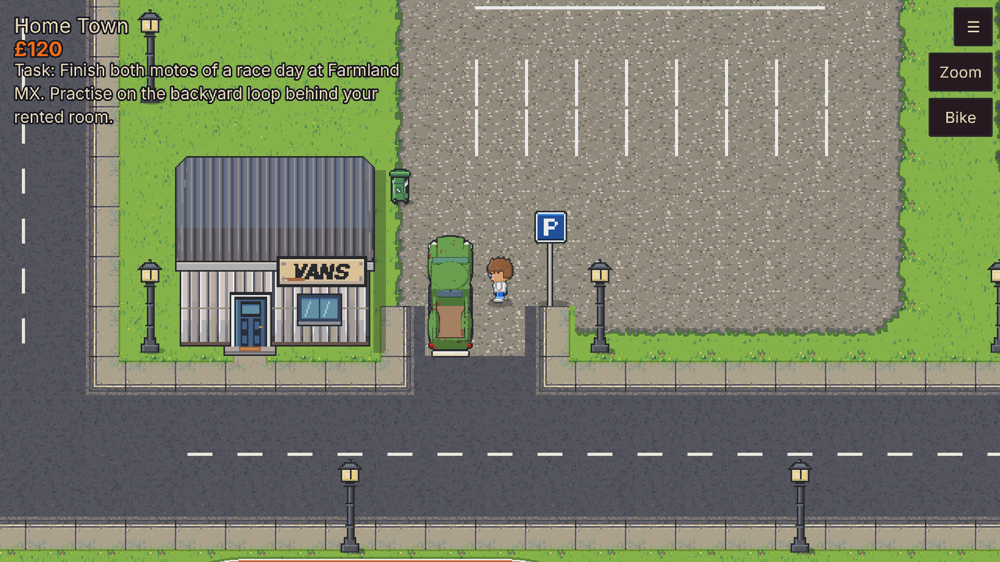
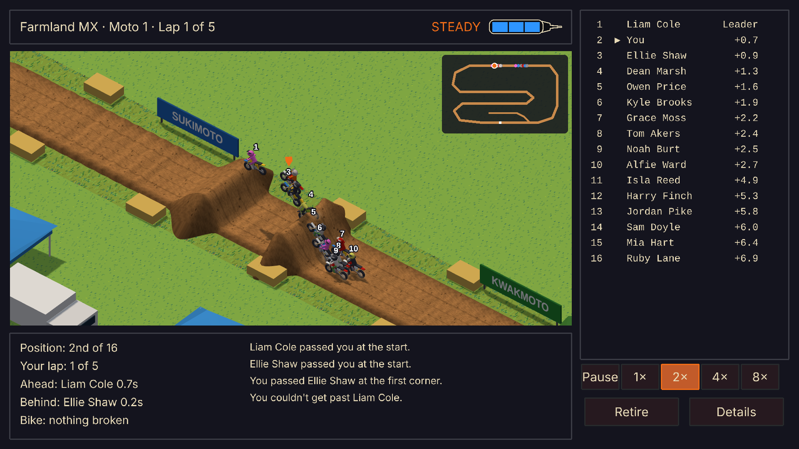

# Motocross RPG: The Road to Legend

A single-player, offline motocross career RPG. Start as an unknown rider with a broken 50cc and work your way up to legend.

| Home Town: the player by the old rusty truck | Race day at Farmland MX: bikes in the air over the double |
| --- | --- |
|  |  |

This is **Alpha v1.1**: the whole career loop from a broken bike to race days at three venues, player-made tracks, and now the **Local Champion Championship** for the Area 1 badge. All art is placeholder art in the agreed style, imported from the project's art threads.

## What Alpha v1.1 offers

The game loop: **earn money, keep the bike going, race, level up, repeat.**

1. **Start a career** in Home Town with a broken 50cc. The garage mechanic's tutorial gets it running and teaches the basics.
2. **Earn money** on shifts in the Industrial Zone: the fabrication shop (frame brackets) and the engine rebuilder (pistons). Pay is per part made, and is boosted 10× while testing.
3. **Look after the bike.** Every lap wears its parts, and a part at 0% breaks. Buy new or better-grade parts at the general bike shop and the tyre shop in Home Town (fitted free, or kept as spares in your bag), and pay the local garage to repair or fit them.
4. **Get a van** and load your bike to reach the tracks on the venue road.
5. **Race.** Three venues are open: **Farmland MX**, **Riverside Arena** and **Longmoor Enduro**, each with a track official at the race office. A race day is two motos of 5 laps against 15 riders, including the Local Champion: £20 entry (your first race day is free), gate picks, a start official and a pit board, with prize money to 10th in each moto. Free practice is 25% of the entry, and the backyard loop at home is free.
6. **Win the badge.** After your first race day, enter the **Local Champion Championship** at any race office: three rounds, one at each track, against the same 16 riders, with qualifying and points for every moto. Win it for the Area 1 badge, which opens the six-round **Area 1 Championship**.
7. **Level up.** Racing and practice train your Rider Ability skills, and better skills and better parts make you faster.
8. **Race your own tracks** with **Mod Track** on the venue road (see *Making and installing mod tracks* below).

It runs in a browser on desktop or on a phone held sideways, and saves automatically.

## Play it

- **In a browser:** once GitHub Pages is switched on (Settings > Pages > Source: GitHub Actions), every push to `main` publishes the game to this repo's Pages site.
- **On your own computer:** install [Node.js](https://nodejs.org) (LTS), then:

  ```
  npm install
  npm run dev
  ```

  and open the address it prints (usually http://localhost:5173).

### Controls

| Action | Keyboard and mouse | Touch |
| --- | --- | --- |
| Walk | WASD or arrow keys, or click where you want to go | Tap where you want to go |
| Talk to an NPC or use an object | Click it, or face it and press E or Space | Tap it |
| Next line of dialogue | Click, E, Space or Enter | Tap the box |
| Zoom (50% to 200%) | Mouse wheel, + and -, or the on-screen zoom control | The on-screen zoom control: a Zoom button with a slider, or + and − buttons (Settings > Display > Zoom control) |
| Bike, bag and current task | Tab, I or B | Bike button |
| Skills | K, or the Skills tab in the Bike panel | Bike button, then Skills |
| Pause menu (save, settings) | Esc | ☰ button |

### Playing on a phone

Hold the phone sideways: the game is laid out for landscape, and asks you to turn the phone if it is upright. For the most room, use the browser's Add to Home Screen: the game then opens full screen with no browser bars. The game draws at the phone's full screen resolution, and panels shrink to fit a short screen.

### Backing up and moving your career

Your career is saved in the browser you play in, so another browser or device starts empty. **Load → Export save** gives you your career as a file (`mxrpg-<rider>-<date>.save.json`): a download on a computer, the share sheet on a phone or tablet (Save to Files on iPhone and iPad, Drive or Downloads on Android). **Load → Import save** on any browser or device picks that file and carries on the career there; Load is open even with no career saved, for this. Importing over a career keeps the one it replaces as Backup 1 under Load. A save from an older build is upgraded on import like any other; one from a newer build, or a damaged one, is refused with the reason. Export now and then as a backup: Safari can clear a website's storage after about a week without a visit (a Home Screen app is not affected). The code is in `src/core/saves.ts` (the file format) and `src/ui/files.ts`.

## Making and installing mod tracks

Mod tracks are race tracks made with the game's track editor and raced in the game from **Mod Track** on the venue road. A mod race day plays exactly like Farmland MX: the same entry fee, field, AI riders, prize money, XP and parts wear. For now, picking a mod track goes straight to the gate pick, without a venue area to walk round, and race day is the only mode (no practice).

**1. Build the track** on a computer: the track editor needs a mouse and keyboard and isn't usable on a phone (racing mod tracks on a phone works, through Import track file). Open the track editor: `tools/track-editor.html` on the published site, or http://localhost:5173/tools/track-editor.html when running `npm run dev`. Choose **New**, draw the route, then add:

- a **start straight**, which needs its own gate and must join the lap;
- a **finish line**;
- a **start board official**, with a walk that ends clear of the track.

Then use **Ready to race**, which runs the game's checks.

**2. Save it.** The editor opens on the mod tracks: the example in `public/mods/tracks/` and any saved there; the game's own four tracks are not listed (the Development edition has a **Show the game's own tracks** tick under the list, remembered in the browser, for working on the game itself). Tracks made with **New**, **Duplicate** or **Import** are mod tracks. The first **Save** asks for the track's name, and the track is saved as its own file, `public/mods/tracks/<name>.track.json`, never into the game's `tracks.json`. It can't overwrite another track: a name already in use is refused.

- With `npm run dev`, use the track editor at http://localhost:5173/tools/track-editor.html and **Load the tracks from this server**. Save then writes straight into `public/mods/tracks/`, and the game picks the track up on its next page load. Saved mod tracks are listed in the editor too, to carry on editing.
- If you **Open folder…** on the project in Chrome or Edge, Save writes into the `public/mods/tracks/` folder there.
- Anywhere else, Save downloads the file for you to put in `public/mods/tracks/`.

**Export** still saves any track as a `.track.json` to share.

**3. Race it.** On your own copy, a track in `public/mods/tracks/` shows under **Mod Track** in the game. For a built copy, rebuild with `npm run build`, because the build writes the folder's `index.json` (a website can't list a folder by itself). With `npm run dev`, **Race it in the game** in the editor opens a race day on a saved mod track straight away. On any copy, including the published site, you can also use **Mod Track → Import track file** in the game to pick a `.track.json` from your device. It is kept in that browser only, and can be removed from its race office. `farmland-example.track.json` is in the folder as an example.

**What a mod track must meet.** The game runs the same checks as on its own tracks:

- it is a track file from the editor (or a bare track), and is not marked as an unfinished draft;
- it is not practice-only;
- it has a start straight with its gate, long enough and joined onto the lap;
- every section type is one the game knows;
- it uses only the game's own surfaces, ground and scenery (custom art isn't supported yet);
- the start official stands and walks clear of the track, the line-up and solid scenery.

A track that fails stays in the list, and picking it shows the reasons. An import that fails isn't added. Each track is listed by its name, with its file name under it. Mod tracks get their own ids, so they never clash with the game's tracks. The code is in `src/core/modTracks.ts`.

## Project status: driving fixes, track editor, buildings and the world map

Done on branch `claude/project-thread-ch8ujf`. The driving controls and feel are unchanged (no driving or physics code was touched), Home Town's map file is byte-for-byte the same (pinned by a hash test), and the race-day camera stays fixed.

- **Driver over the van:** on turning frames the van sheets mark the whole cab as the window, so the seated driver was drawn whole on top of the van. A turning frame's window is now used only when it is about the size of real glass; otherwise the driver is hidden by the roof (`src/world/VanView.ts`).
- **Panel text overlap (Bike, Skills, Local garage):** one-line labels and list columns (such as the garage's repair notes) are narrowed to fit their column instead of running into the next, the Bike stats sit below the bike's note, the Skills rows share the room above the footer note, and the shop title stays above its tabs. Checked at 100%, 130% and 180% text size.
- **New tracks start empty:** in the track editor, New track makes an unfinished (draft) track with no lap. Build the lap lists the section types; the piece follows the pointer, Q/E turns it, F mirrors it, B bends it, `,` and `.` shorten and lengthen it, a click or Enter places it and Esc cancels. A piece must join the end of the last one (gaps and kinks over 20° are refused with the reason); the piece that meets the first closes the lap. Ready to race runs the game's checks. The game leaves draft tracks out. Existing tracks are unchanged.
- **Start straight, start official and a deeper ground range (refinement):** Build the lap now has a **Start and finish** box. **Start straight** places it like a piece: it follows the pointer and snaps onto the lap (or stands free on an empty draft, and the lap is then built from its end), Q/E turn it, F changes the side it comes in from, `,` and `.` shorten and lengthen it, it shows green or red with the reason, a click or Enter places it and Esc cancels. **Move start straight** and **Remove start straight** are beside it. The race starts from the gate along it and the run to the lap is not counted as a lap. **Start board official** (with a picture of the official and board) picks the official in Scenery or selects the one placed; it can be placed, turned and routed before there is a start straight, and stands where placed until there is one. Checks on a new track say when the start straight, the official or its route is missing. Raise and Lower now go to ±36 m (was ±24 m, 1.5 times), with a 3 m strength added and a message when a dab reaches the limit; nothing is clamped silently. Where the start straight runs into the lap on sloping ground, it eases to the lap's level so the two surfaces meet. Tracks without elevation (all the shipped ones) are unchanged.
- **Editor camera turns:** Turn left, Turn right and Reset view buttons at the bottom left of the race view, the `[` and `]` keys, or Shift + middle-drag to turn freely. Clicks land on the ground under the pointer at any angle; the race keeps its fixed camera.
- **Start official (start-board holder):** a `start_official` scenery item. In Scenery, place it like any other item, then Draw route and click the points of the walk; points can be dragged, and Cancel and Reset route are there. The walk must be at most `official.maxWalk` grid units (8, in `public/data/trackParts.json`), keep out of solid scenery and the riders lined up at the gate, and end clear of the track; the race walks it between five and one second before the drop, with the board sequence unchanged. Farmland places it as in the reference picture.
- **First corner, closing the lap, deletion and holder placement (refinement 2):** an unfinished lap is now drawn open, with square ends and a ring at each open end (green to build on from, blue to close into), instead of through a hidden link back to the start that bent its ends and notched the first corner. Bend headings are exact (they drifted about 1.5° a bend). Pieces join any open end; **Close the lap** (or **Close the gap**) shows and lays the bends and straights that join an end to its target, preferring fewer, wider bends, never a loop, and saying why when it can't. Section ✕ now removes the piece and its stretch of track, leaving a marked gap that can be built across or closed (Shift+✕ keeps the old label-only removal); the race view drops the deleted track at once, and undo, redo, save and reload keep it consistent. The **start board official** panel has a **Start position** slider and side to stand them anywhere along the start straight, trackside, and **Plan walk** finds a clear destination within reach; it shows the timing (board up and off at 5 s, sideways at 3 s, arrives and lowers at 1 s, top speed). Moving or turning the start straight takes the official and their route with it. The countdown, driving, AI, ±36 m ground, Home Town and the shipped tracks are unchanged.
- **Track raised and lowered along its length (elevation tool overhaul):** the Height pane's main tools now raise and lower a stretch of the track rather than painting the ground under it. The old brush painted a ground lattice two grid units apart and the track took its level from the ground under its centre, so uneven dabs beside the centre line pushed the edge vertices up cell by cell (the torn, stepped edge), the ground eased out to a raised track over a fixed 3 units however high it was (a near-vertical mud wall) and every dab piled onto the last. Now a raise or lower is stored on the track as a hill (where along the route, how long, how high in metres), the track's level is the ground under its middle plus its hills, the hill's shape is a raised cosine that is flat at its peak and at both ends, and the grass ground either side is graded to the track's level at the foot of its bank and runs down to the land at no more than 1 in 1.5. The ground under the riding surface sits exactly at the track's level, so no part of the track is pushed up by it, and the bank's foot runs a little under the ground so the ground never shows through. The surface model, the race view's mesh and terrain, collision, the lap profile and grades, the steep-track warning, the height limit check, the rider AI, saving and reloading, route edits and the start straight's join all follow the hills. Tracks without hills are unchanged and the shipped tracks export byte-identical.
- **Separate start, circuit and finish line; free joins; tight corners (refinement 3):** the finish line is its own component. New tracks have none (`finish: false` while unfinished): closing the lap and joining the start straight create nothing, and a closed circuit with no start straight or finish line is a valid draft that saves and reloads. **Finish line** (Start and finish, or **+ Finish line** above the view) snaps a chequered bar onto the closed lap; placing it makes that spot the lap's first point (a point is added if none is there), splits and turns the sections round so the lap is laid out as before, and keeps surface patches in place; **Finish here** does the same for a selected point, **Remove finish line** takes it off, and the map and race view draw no chequer until one is placed. The start straight joins the lap anywhere, about a metre before or after the finish line included (a join just before the line makes lap 1 the start straight and a whole circuit; the old "first half of the lap" rule is gone); its end, the green ring, drags freely until there is a lap, then along the lap, and turns red with a Race start check when it is off the lap. While a piece is in hand a click on the start straight's points moves them unless the piece is joining there (the immovable green circle was the start straight's end, which placing mode swallowed and whose drag crashed without a lap). Checks are grouped **Circuit**, **Race start**, **Finish line**, **Height** and **Geometry**: a missing start straight or finish line is listed as still needed to race, never as a fault, with a ✓ line for each part in place; Ready to race asks for them. The race view's surface no longer folds inside a corner tighter than a lane is far from the middle of the track (the inner lip swept across the apex as a raised wedge): such a lane is mitred to the point where its straight edges in and out meet, bikes drawn in it swing round the centre of curvature instead, and **Geometry** lists each corner too tight for the edge to follow, with Round corner as the fix. Saved tracks are byte-for-byte unchanged.
- **Fixed sections, five moulding points, the build boundary, cheering fans and race incidents (refinement 4):** once placed, a section never changes: a new piece joins an open end and leaves every earlier section's points, metres and type exactly as they were, and on a piece-built lap dragging a point re-measures only the sections that point belongs to (a shared join lengthens one and shortens the other, and nothing beyond either moves). Straights, jumps and the start straight are placed with **five moulding points** each, so they can be shaped on their own; corners and hairpins keep their own counts. The **build boundary** (the 100 × 60 race ground) is drawn as a translucent dashed line on the map and in the race view; while building, one piece may cross it by up to 12 grid units with a warning naming the section and where it leaves, Checks lists it under Geometry, the track is not ready to race until it is back inside, and a saved track left crossing reloads as a draft; scenery may stand up to 20 units outside, on the ground the race view lays round the grid. **Cheering fans** are a scenery type of their own (apart from the start official): a box figure in four body shapes and any shirt colour, with an action (arms up, wave, clap, fist pump, celebrate) played when a bike passes within 7 grid units, each fan after its own delay and with its own rest between, so a crowd never moves as one; **Draw route** gives a fan a walk in, which they walk at 1.6 grid units a second when the track loads, and a fan on the track, where placed or where the walk ends, is an error the game refuses. In the race simulation, on lap 1 a drawn chance (`sim.firstCorner` in `racing.json`: 30%) puts one to three riders down in the lap's first corner section, never always the player, and any crash can take a nearby rider down with it (`sim.pileup`: 35% within 0.8 s, at most 3); the start straight's bend onto the lap is not a corner section, so it never hosts the first-corner incident. The ground height range stays at ±36 m.
- **Layout-first editor (overhaul):** the piece-by-piece building workflow (pieces, gaps, Close the lap) is gone from the editor. A track's lap is a route of control points with curve handles (`layout` in tracks.json when any point is smooth), the drawing the game races is generated from it, and jumps and special sections are `features` on the route from which the sections are generated. Drafts save at any state (a point, an open route, no start or finish, warnings), the Route box shows Draft / Draft with warnings / Ready for validation / Race-ready, and nothing becomes race-ready without Ready to race. Existing tracks load and save byte-identical, keep their sections, and race as before; see docs/TOOLKIT_INSTRUCTIONS.md.
- **First marker, first corner and free section placement (refinement to the overhaul):** the first click of **Draw route** shows at once in both views (a ringed point with a dashed preview to the pointer), each point placed is its own undo step, and points can be dragged while drawing. The **First corner** is no longer a section type to place: it is the start straight's end, the stretch of the route from where the straight joins to the route's next control point (`firstCornerSpan` in `src/core/trackGeom. (Since moved to the start straight itself: see the first-corner bullet below.)ts`), which the race times as its own stretch and rides with the first corner's existing difficulty, skills, damage and lap 1 incident; a feature placed there (a berm, a rutted corner) rides as itself, and tracks saved with their own `first_corner` section keep it. Nothing is typed from the route's shape any more: between features the route rides as plain track, and every corner type (flat corner, berm, rutted corner, hairpin, fast sweeper) is a feature placed by hand, of any shape, keeping its type when moved or reshaped; the editor's and the game's checks no longer tie a section type to a drawn shape (`layoutProblems` in `src/core/trackCheck.ts`), while the geometry checks (self-crossings, corners tighter than the edge, the build boundary) stay.
- **The first corner is the start straight's end (refinement 5):** as agreed, the first corner is the leg between the start straight's last two points, the bend onto the lap, not a stretch of the lap after the join and not a section. The race times it as its own stretch of lap 1 (`lapPlan`'s stretch -2, after the run from the gate, -1) and rides it with the first corner's rules (`racing.json`'s `first_corner`: difficulty, skills, damage) and lap 1's first-corner incident; the rest of the start straight rides as the start (gate bonus, start skills) as before, and the section times panel names it. On a start straight of only two points it is the last quarter. **First corner** is gone from the section drop-down, no section row is marked as it, and a First corner section on an older track (the game's own four keep theirs in their data) rides and shows as a flat corner; the example mod track and the test fixture are cleaned up. The map draws the stretch blue, labelled First corner in Layout, and the route note and Checks give its length. Riders cooling down after the flag who took it within three seconds of each other heading for opposite edges now hold single file while they pull over, so they never ride through each other. `src/core/trackGeom.ts` (`firstCorner`), `src/core/race.ts`, `src/core/riderAI.ts`, `src/scenes/RaceScene.ts`, `tools/track-editor.html` (`firstCornerLeg`).
- **Route marshals don't block travel:** leaving by a road with a choice of places asks "Where to?" at the road itself, on foot or in the van, instead of turning you back to talk to the marshal; a place picked with the marshal still goes straight there, and the van drives past marshals.
- **Buildings:** `public/data/buildings.json` is a library of every building: a footprint of any size or shape (`#` solid, `.` walkable, space for none), the pictures it is drawn with (pieces of sheets), its doors into interiors and its return tiles. In the map editor (`tools/map-editor.html`), Buildings lists them; Place shows the building green where it fits and red with the reason where not; a placed building can be selected, moved, replaced or removed. Edit… and New… open the building editor: paint the footprint, add pictures, doors and returns, and New interior from this copies an interior as the building's own. Unfinished buildings save as drafts and can't be placed. The game checks every placed building against its entry (`src/core/buildings.ts`). Doors still work through the existing door and return objects (`src/core/travel.ts`).
- **World map removed:** the world map screen is gone. The places it listed are kept as data (`places` and `routes` in `public/data/world.json`). A route marshal stands by each area's way out (Home Town, Industrial Zone, Farmland, Quarry, Woodland; `guide: true` in `public/data/npcs.json`) and reads its directions from that map's real exits, including shut roads. For a road with a choice of places, pick one with the marshal or at the road when you leave; the bus stop no longer fast-travels. Minimaps are unchanged. A new area needs only its exits, a route entry if an exit has a choice of places, and a marshal entry.

Tests: `npm test` (232 tests) and `npx tsc --noEmit` pass. For the elevation tool overhaul, a Playwright suite drove the editor's UI and race view through 21 checks, all passing: the Height pane opening on Raise the track with its length and height; the preview highlighting 16 units centred under the pointer on a straight, on the map and as a band in the race view, changing at once with the length setting, following the route round a corner, and changing nothing; a click applying exactly the previewed stretch; a raised straight with its peak at the centre, monotonic, symmetric and back to level at both ends; a lowered straight the same; a raised corner with every lane's position, banking, centre profile and skirt byte-identical; a hill on a section boundary changing no section or feature; a hill over the finish line wrapping as one hill; the same stretch clicked twice more stepping one hill to 3 m; undo and redo; the riding surface's edges exactly on the surface model through the hill with the bank's foot under the ground; the grass side graded from the track's level down to the land at no more than 1 in 1.5 on the terrain mesh with the ground texture; collision matching the surface; the five hills saved and reloaded identical with the track still race-ready; and the shipped tracks byte-identical. Unit tests cover the hill profile, wrapping, cutting at open ends and overlap, the lift and the unchanged cross-section on Farmland, continuity, grades, the steep warning and the height error, the schema and a race. Then the holder walk and four full races (Race 8×, 4×, 2× and 1×, 16 riders, 5 laps) on the suite's track with its five hills all finished in order with every rider on 5 laps, nobody stuck or going backwards and no errors, riders slowing over the 3 m hill. For the first-marker, first-corner and free-placement refinement, a Playwright suite drove the editor's UI and race view through 36 checks: the first click shown at once with its preview, undone, redone, dragged while drawing, place-move-place reversed by three undos, Esc clearing the preview; a route of five points with two rounded corners making one plain section and no typed corners; a flat corner on a straight, a hairpin on a 90° corner and a rutted corner on a sweep placed by hand, stretched, moved and the route reshaped under them with every type kept and no shape warning; a feature placement cancelled and undone leaving everything as it was; the start straight joined with no First corner section made, the first corner reported from the join to the next point and moving with the join; the draft saved, reloaded and made Race-ready; Farmland byte-identical with its own first-corner section kept, and Use features keeping every corner type. Unit tests cover the first corner's span, its own timed stretch each lap, its difficulty applied to that stretch only, lap 1's incident landing in it, and any type on any drawn shape passing the layout check. For refinement 4, three more Playwright suites drove the editor's UI and race view through 35 checks, all passing: every kind of join (straight to corner, corner to straight, straight to jump, jump to straight, corner to hairpin, hairpin to straight, turned and mirrored) leaving every earlier section's points, metres and type unchanged, heights under the track kept, the start straight added and the lap closed with nothing moved, saved and reloaded identical, a section deleted leaving a gap with nothing else moved; five moulding points on straights, jumps and the start straight, a middle point dragged moving only its own section's metres, undo, redo, save and reload; the boundary crossed by a dragged point and by a placed piece (named in Checks, not race-ready, reloaded as a draft, a second piece refused while one is out, far out refused, back inside ready again), scenery outside to the margin; and fans placed, set up, routed, refused on the track, saved and reloaded, built in the race view with their own timing, walking in at walking pace to exactly the end of the route, and reacting to a passing bike and resting. Unit tests cover the fans' checks and schema and the first-corner incidents and pile-ups (10–60% of races, sizes vary, in the first corner on lap 1 only, the player not always down, laps intact). For refinement 3, a second Playwright suite drove the editor's UI and race view through 29 checks, all passing: a circuit built and closed with no start straight (nothing laid, no finish line, valid draft, saved and reloaded); the finish line placed, moved, put on a selected point, dragged, removed, undone, saved and reloaded in place with no extra key; the start straight joined part way round and about a metre before and after the finish line with the lap untouched, Ready to race passing, an invalid join explained; the green ring dragged freely before there is a lap, placing a piece on it, dragging it along the lap, a broken join flagged and dragged back on; the Geometry warning for knife-edge corners and Round corner clearing it; and an existing track's checks, Reverse and export unchanged. Unit tests cover a start joining just before and after the line (5 laps, no extra or missing lap), the mitred corner (no lane folds, lip stands as a kerb, same on slopes and reversed, AI riders through), bikes kept moving and on the surface through the tightest corners of every shipped track, and a race on the track built in the suite. For refinement 2, a Playwright suite drove the editor's own UI and race view through 30 checks, all passing: building from a start straight placed first through a First corner and on round, rotating and moving pieces, the refusals and their reasons, Close the lap, a continuous loop, saving and reloading open and closed; deleting pieces (no track triangles left where they were, open ends shown, neighbours kept, old views disposed, undo and redo, repeated delete and close, save and reload with a gap); and the holder near the gate, mid-straight and at the far end, Plan walk, the walk timed in the race view itself (at A until 5 s, at B from 1 s, no jumps, the whole route walked), refusals, the start straight turned and moved, and save and reload. Then three full races (Race 8×, 16 riders, 5 laps) on the circuit built in the suite, with its holder, and one on Farmland all finished in order with every rider on 5 laps and no errors. In one of the three, a serious crash in the first corner held most of the field for about 15 seconds behind it, which is the race simulation's existing passing rule. For the earlier refinement, a brand-new track was built through the editor's own UI (start straight placed first, turned, moved, cancelled and undone, a lap built from its end and closed, saved and reloaded as a draft, the official placed, turned, routed, saved and reloaded, Ready to race passing), and full races (Race 8×, 16 riders, 5 laps) were run on Farmland flat, at ±24 m and at ±36 m (four times), and on the new track flat, on a 36 m hill and in a 36 m dip: every race finished in order with every rider on 5 laps, nobody stuck or going backwards, no errors. In-game runs through the real UI with Playwright: a full race on Farmland (Race 8×, 16 riders, 5 laps, results in order, no editor camera), an Auto Complete start on Farmland (riders still through the hold, board sequence, official in frame, gate drop at 0), all 10 Home Town doors walked in and out, a custom building walked into and out of, every route walked and the van driven out by a route.

Known limits: a finish line placed inside a bend splits that section, and a short remainder may then need retyping (the ghost warns; a straight is the usual place). Bikes drawn right on the edge of a knife-edge corner swing round its centre of curvature, a few centimetres back for a moment, while the surface there is a mitred point; the Geometry check names such corners. In deep valleys the fixed race camera can lose riders behind nearer high ground. Bikes dip up to about 0.6 grid units into the surface for a moment at some jump crests, flat or not (as before this change). Ground steeper than the 35% warning is still allowed. Opened straight from disk, the editor runs the published game, which gets these changes only once PR 20 is merged. The marshals reuse the running coach's sprite (no art for them yet). Buildings can't be rotated, since each picture is drawn for one view. The L-shaped engine rebuilder with lock-up is in the library but not placed on any map. The 35×18 example block fits on no shipped map and was tested on a blank map.

To resume: `npm install`, `npm test`, `npm run dev`, then open `/tools/` (the toolkit) or `/tools/track-editor.html` or `/tools/map-editor.html`.

## What's in this build

### Alpha v1.1: championships

Checked against the last open line of the "Starter career slice" checklist (Systems Specification section 22): the Local Champion championship (3 rounds, one per track, 16 riders with qualifying) awards the badge, and the main area championship (6 rounds) then unlocks.

- **Two championships** in a new content file, `championships.json` (checked at start-up): the **Local Champion Championship** (rounds at Farmland MX, Riverside Arena and Longmoor Enduro) and the **Area 1 Championship** (two rounds at each, in the same order), both 50cc (Spec 12.5, 18.6).
- **Entering.** Every race office has a **Championships** choice: enter one, see where you stand, **Start again** from round 1 against a new field, or **Give it up**. The Local Champion one opens after your first race day; the Area 1 one needs the badge. Entering is free; each round is entered at its own track's race office, where **Local Champion round N** replaces the local race day while your next round is on there (Spec 18.6, 6C). There is no calendar, so a championship waits until you ride its next round.
- **The field.** 19 CPU riders drawn from the Area 1 pool when you enter, the same at every round. Each championship has a **main rider**, the one to beat and the best rider in it on skill (Boss, 28 Oct 2026): **Louis Jonez** (now level 15) is the Local Champion, and **Dean Marsh** is the placeholder Area 1 Champion. Dean stays out of the Local Championship; Louis races in both. Everyone else races **10% better** in a championship (skills and bike condition), set by `buff` in `championships.json`. Normal race days and challenges are unchanged.
- **Qualifying** at every round (Spec 12.2): an untimed out lap from the gate, then 3 timed laps with the pit board as in a moto (or Auto-complete). The best timed lap sets the gate pick order for moto 1; it scores no points. The live tower shows the order of best timed laps. Qualifying wears the bike and gives the laps' XP (no finishing bonus), and counts as one step for the ruts (Round 111).
- **Field of 16.** Championships race 16 riders on two rows of 8, the same start as a race day (Boss, 28 Oct 2026: it looks cleaner than 20 on three rows).
- **Motors stay on the road, on the left** (Boss, 28 Oct 2026). A motor's body keeps to the road, car parks, gravel and concrete; only its front or back (two tiles for the Factory Hauler) pokes over the pavement or grass to turn round (`kerbs` in vehicles.json). Two-lane roads are driven on the left: east in the top lane, west in the bottom one, north on the left, south on the right. Steering and click-to-drive keep to the lane and a U-turn swaps lanes; junctions, car parks and entrances shorter than 4 tiles have no lanes. Too long to turn round on a two-lane road, the hauler turns at junctions instead.
- **Vans are motors** (Boss, 28 Oct 2026). Everything said about the van says motor; the seller is the Used Motor Seller in the Used Motors building (its sign too). The designs are motor-1 to motor-7, with saves carried over (save version 6); the van models and art files keep their names (`art` on each design).
- **Area Champion by name.** The Area Champion at Farmland shows their rider's current name over their head (Dean Marsh for now, from `rider` in npcs.json) and says they're the current Area Champion.
- **Dan Smyth** is an old bald racer with the Farmland track official's white beard, in an orange and black kit with no helmet (`tools/art` character script in project files).
- **Roadworks until Louis.** The roadworks on the west road out of Home Town (the way to Farmland and the other tracks) stay up through the tutorial and the van, and come down when Louis Jonez tells you where to race (Boss, 28 Oct 2026).
- **Route marshals removed** (Boss, 28 Oct 2026). Roads out with a choice of places ask "Where to?" at the road, as before.
- **Chat windows:** Next and Close are a black-on-orange button in the corner of the box. Racers who don't talk before the tutorial is done go by their name ("Louis Jonez doesn't look up."), not "The louis jonez".
- **Gate picks.** The first three in the pick order always take the three best gates, so a player picking 4th or later never finds them free. After that, CPU riders still have a favourite spot and their own feel for each gate, but neither ever outweighs a gate 2% better. Two riders each moto (one of picks 4 to 6, one of picks 7 to 12) skip a couple of gates or more for a spot further out (still within 2% of the best left), so the start never fills in a neat line.
- **Money.** A round costs 1.5× the class entry (£30) and pays 1.8× the prize money (Spec 14.2). Final standings pay the top three: £150 and the Area 1 badge, £75, £40 for the Local Champion; £300 and the Area 1 Championship trophy, £150, £80 for the Area 1 Championship (provisional numbers). A championship you have already won pays half the XP, prize money and reward when you ride it again (Round 125).
- **Points** for every moto on the usual table, DNF 0. Ties go to the most moto wins, then the better result in the latest moto (Spec 12.4). After each round the standings screen shows every rider's points by round, the gap to the leader, the next round, and whether the title is still possible. After the last round it shows the final result and the reward.
- **The Task tab** lists each championship under way and the badges and trophies won, and the journal points you to the next one. Winning the Area 1 Championship says the next class and Area 2 come in a later build.
- **Saves** keep the championships on the career (`career.champs`), added when you first enter one, with no migration needed for that (the renamed ids below bring saves to version 5).
- **The Area 1 badge** is a knobbly motocross tyre with a gold rim and an orange "AREA 1" centre (`public/assets/art/ui/badge-area1.png`, drawn by `tools/art/badge-area1.py` in the reference palette). It shows on the final standings when you win the Local Champion Championship, and in the Task tab once won. A reward can name its picture with `image` in `championships.json`.
- **Riders in free practice.** Practice at Farmland MX, Riverside Arena and Longmoor Enduro now has 10 riders from the area's pool out on track with you, spread round the lap, each with their own name and colours (`practiceRiders` on a venue in `tracks.json`). The backyard loop stays yours alone. The lap counter, XP and wear on the practice screen follow the clock, so stopping early counts only the laps you have ridden.
- **Boss's new area maps.** Home Town (now 48 × 36 tiles) and the Industrial Zone (40 × 30) are smaller at the same 4:3 shape. Home Town's 48 × 36 is the default size for every new area, Areas 2–8 included (Boss, 28 Oct 2026; also in the art style guide). In Home Town the north and south roads are closed (for later areas), the west road opens after the tutorial and the east road goes to the Industrial Zone; the route marshal, the starter van's parking bay and the backyard loop moved to their new spots, and the roadworks blocker covers just the dug-up road so the lamp post and zebra crossing beside it stay put. The Industrial Zone lost a stray pipe piece past its east edge. The bike shop has its new collision.
- **Riverside Arena** is now a big indoor arena across the top of its map (`riverside-arena.png`, drawn by `tools/art/arena-riverside.py` in the reference palette), with double glass doors on the venue trigger in place of the MX track gate.
- **Riverside and Longmoor ids.** The venues formerly called Quarry and Woodland now use their names everywhere: maps `area1-venue-riverside` and `area1-venue-longmoor`, venues `venue-riverside` and `venue-longmoor`, and their track officials and route marshals. Saves move to version 5, and an older save's ids are renamed when it loads.
- **NPC name tags:** every NPC shows their name over their head in white with a dark outline (Boss's design A), indoors and out.
- **Pavements:** the player now stands on the paving of one-tile pavements as the NPCs do, instead of looking as if they are on the kerb.

#### World map (Boss, 28 Oct 2026)

The **Map** button (or **M**) opens Boss's world map: Areas 2 to 8, the Race Hub with its tracks, Home Town and the Industrial Zone, the Tracks badges and the roads between them. The only marker is your biggest bike, in its brand colour with no outline, standing in the middle of the zone you're in. Inside a building, that's the zone of the map its door is on. Travel is still by the roads out.

- The art comes from `tools/art/world-map.py`, which draws the map, a version of Home Town and the Industrial Zone without their little pictures, and a map bike for every class and brand.
- `data/world.json` `worldMap` lists each zone's maps and where its bike stands (`src/core/worldMap.ts`).

#### Tutorial markers (Boss, 28 Oct 2026)

Every step of the opening chain shows where to go next (`src/core/waymarks.ts`, drawn by `src/world/Waymarks.ts`):

- **The NPC to talk to** has an orange "!" bubble over their head.
- **The equipment to use** has a glowing orange outline with sparkles. On a step that needs two, like the two customer bikes, only the ones still to do are marked.
- **The building to go into** has a big orange arrow over each of its doors and a glow on the doormat.
- **The way to go** is an arrow on the exit, or out of a building, that leads there. While the marker is off screen, an arrow at the screen edge points to it with the place's name, such as "Industrial Zone, Engine rebuilder".

Markers come from `story.json` and the maps' doors and exits, so a new step needs no marker data. They never point down a road that is still shut. Reduced effects (Settings) keeps them still.

#### After the tutorial: challenges, errands and records (Boss, 28 Oct 2026)

- **Story after the tutorial.** The garage mechanic gives a word of advice the first time you talk to him after the opening chain: level up your skills, watch your parts wear and upgrade them, and how repairs work (one grade down at 100%; Grade 1 and broken parts can't be repaired). Then he points you to Mickey Alington by the practice track gate. The fabrication shop boss tells you about Dan Smyth by the Industrial Zone practice yard. Both are in the Task journal until you've heard them (a `talk` rule with `sets` in `npcs.json` is said once).
- **Challenges** (`challenges.json`, `src/core/challenge.ts`). **Mickey Alington** at the Home Town practice track gate races you for **£50**, 8 riders over 3 laps. **Dan Smyth** by the Industrial Zone practice yard races you one on one for **£70** over 3 laps. Win, and you get your entry back plus the same again; anything but first wins nothing. Win or lose, you can race again straight away, with normal wear and XP. Each challenge needs its own new track, so until that track is in `tracks.json` the challenger says it's still being built.
  - **Win chance comes from the bike.** It averages every part's condition across the bike, so a part at 100% and one at 40% count as two at 70%. On a 50cc with all parts at 75% it is 50%, going up or down 1% per 1% of condition, between 5% and 85%. Bigger classes are easier: 65cc is 85% at 75% (95% at most) and 85cc small wheel is 97% (99% at most). Nothing is ever 100%. Rider skill doesn't count in Area 1. The odds are a table per challenge in `challenges.json`, to balance with Boss, ready for Areas 2 to 8 to aim at bigger classes.
  - **Walk-off hint after a loss** (Boss, 28 Oct 2026). The challenger says one more line, a general hint that never names a part, so you learn what to upgrade. If the bike averages under 75% it's the bike ("Your bike sounded a bit tired out there"); otherwise you were just unlucky. From Area 2 (to agree with Boss) a bike in good shape gets a riding hint, then a fitness one, when that skill is below the challenger's level.
  - The result is rolled first. Then the game draws a moto that plays out that way if you hold your starting message, so auto-complete always matches the roll. In a live race the pit board can still change it. A loss is one where you finish behind someone. A moto where your bike gives out is never picked to make a loss.
- **Scrapyard errands** (`errands.json`, `src/core/errands.ts`). The **scrapyard owner** in the Industrial Zone lends you one of his worn parts (Grade 2 or 3, 30% to 70%, never broken) to get repaired at the garage and bring back. He pays you back the repair plus **£5**, to be balanced later. You get one job at a time, and the next one is offered straight away. The part is tagged as his in the save. It can't be fitted, sold or dumped (or put in the modifier machine, when that comes), and trying says "I don't own this part. I'm trusted to fix it and take it back to the scrapyard owner." It is repaired from the garage's Repairs tab.
- **Records tab** in the bike/bag/task panel. It shows wins out of attempts for race days at each track (such as "Riverside Arena: wins 3/26"), each championship (with your best finish) and each challenge. Championships stay repeatable after a win, with no second badge or trophy. Race days are counted per track from this build on.
- **New NPCs.** These are Mickey Alington, Dan Smyth, the scrapyard owner and **Neal Gizard**, the end-game racer. Neal stands by the closed south road in full MX kit and helmet, and for now he only tells you to come back on a 450cc. The local racer is now called **Louis Jonez**. The new sprites are made by the shared character generator (`art/characters/tools/make_characters.py`, npc-13 to npc-16).
- **Half concrete, half mud.** There are three new section types: **Concrete straight**, **Concrete corner** and **Concrete to mud**. A track can now have a concrete base surface. A first draft of Dan's Industrial Zone challenge track is in the mod tracks folder (`public/mods/tracks/industrial-challenge.track.json`) for Boss to brush up in the track editor. It has a concrete yard with tight corners and a chicane, and a mud half with whoops, ruts and berms.

### Alpha v1: three race venues

- **Riverside Arena and Longmoor Enduro are open.** The two tracks that were editor test tracks are now race venues in the game, on the maps that were Quarry MX and Woodland MX (the map and venue ids stay `area1-venue-quarry` / `venue-quarry` and `area1-venue-woodland` / `venue-woodland`, so saves carry over). Each has its own track official by the race office (`npc.track_official_quarry`, `npc.track_official_woodland`), the same 16-rider field, and the same prices as Farmland MX: £20 entry, practice at 25% of entry, and the first race day of a career free.
- **The start official** stands on the start straight at all three tracks and walks off it before the drop, placed in each track's data (a `start_official` scenery item with its route).
- **A natural line-up.** CPU riders pick gates they like (most want the inside, but each has a favourite spot), and riders roll up to the gate in pick order, front row first, so the start fills unevenly.
- **Mod Track: race player-made tracks.** "Mod Track" is on the venue road and every venue lane (the route marshal lists it too, and it needs the van like the venues). Picking it opens a list of mod tracks by name, with the file name under each; picking one goes straight to a race day and its gate pick, with no area to walk round. A mod race day is the same as Farmland MX: £20 entry (no free first race), the 16-rider local 50cc field, 2 motos, prize money, XP and parts wear. Race day only, no practice.
  - **Installing:** put the `.track.json` files the track editor's **Export** button makes in `public/mods/tracks/` (`mods/tracks/` beside the built game). The build (and `npm run dev`, on every load) writes an `index.json` of that folder for the game to read. `farmland-example.track.json` is there as an example.
  - **Importing:** "Import track file" in the list loads a `.track.json` from your device and keeps it in that browser; an imported track can be removed again from its race office.
  - **Checks:** every mod track gets the game's own track checks (schema, sections, start straight, the start official's spot and walk, and only the game's own surfaces, ground and scenery). One that fails stays in the list and says why when picked; a failed import isn't kept. Mod tracks use the game's own art for now. See `src/core/modTracks.ts`.
- **Shift pay is 10× while testing** (`testPayMultiplier` in `public/data/world.json`; review before Final v1).

### Added to test build 0.3: your van on the map

Following Boss's brief "Seven Vans, Vehicle Gameplay Integration and Bike Model Updates" (24 Oct 2026). Art and the full audit are in the shared art folder under `art/vehicles/`.

- **The van you buy is on the map.** The £600 used van from the opening chain is the Old Rusty Truck Short, parked in the car park behind the van seller's office. You own one van at a time; a new one will always be a part exchange, so the save keeps one van and one parked spot.
- **Get in:** click the van, or face it and press E or Space, then pick **Drive**. **Open the back** opens the rear and shows your bag; **Not now** leaves it.
- **Drive** with WASD or the arrow keys: ahead drives on, a side turns at the next gap, and back turns round across the road (or reverses where there is no room). Or click or tap the road and the van drives there, round corners and through junctions; a long van that can't turn round in the road backs into a side road and pulls out the other way, like a three-point turn.
- **Smooth driving** (Boss, 25 Oct 2026: "driving needs more fluid movement"): the van speeds up, holds cruising speed while a key is held, slows for corners and brakes to a stop exactly on a tile. It turns through 32 angles, the back following the cab round the corner like a lorry's, so a long van swings wide instead of spinning on the spot, and a turn is only made if no part of the van passes over a building, wall or person. Vans stay on roads, pavements, car parks, gravel and concrete, never grass, buildings or doors. **Get out** with E, Space, the **Get out** button or a click on the van: you step out on the driver's side, and the van stays exactly where it is.
- **Collision:** a van is a solid footprint one tile wide and as long as the real vehicle (2 to 9 tiles). It can't drive into NPCs, though on foot you still walk through them, and you can't walk through a parked van.
- **Map changes:** drive through an exit (Home Town to the Industrial Zone and back) or onto the venue route, and the van comes with you, parked at the arrival point facing into the map. Walk out instead and it stays where you left it; nothing brings it to you. It is saved with its map, tile and facing, so it is still there after a reload. Saves go to version 4; an older save with a bought van gets it at the starter spot.
- **Seven designs** (`public/data/vehicles.json`), drawn from Boss's reference photos and named after them: Old Rusty Truck Short, Old Rusty Van, MX Van Short, MX Van Medium, MX Sports Motorhome Medium, MX Sports Motorhome Long and Factory Hauler. For playtesting, add `?van=van-7` (any of `van-1` to `van-7`) to the address to swap your van's design.

### Added to test build 0.3: parts shops and repairs

Following GDD 8.3 to 8.5 and Spec 7.4 and 14.4 to 14.6. Shops open once the opening chain is done; talk to the shopkeeper or click their counter.

- **General bike shop:** top end, bottom end, intake and exhaust, drivetrain, forks, shock, and bodywork and controls. **Tyres and wheels:** wheels and tyres, and brakes. Both stock Grades 1 to 3 for 50cc and 65cc (Spec 14.5a). Grade 1 is always on the shelf; Grade 2 and 3 parts come and go, and each one sells out until the stock changes. Stock changes after 3 race days or 10 other activities (finished shift batches and practice sessions), Spec 14.6. Frames aren't sold: they come from your sponsor or the class dealer.
- **Prices** follow Spec 14.4: each grade costs 2× the one below. A Grade 1 top end is £35, tyres £25, forks £120. New parts are at 100% with no modifiers. The buy box shows how each bike stat would change.
- **Buy and fit** (the shop fits it free) or **buy as a spare**. A part you take off goes in your bag; a broken one goes straight to the dump. You can carry 20 spares.
- **Sell** spares at either shop: price × (20% + 40% × condition) × demand (0.9 to 1.1, new at each stock change), and half that at the shop that doesn't specialise in the part. Broken parts can't be sold.
- **The garage** (talk to the mechanic, or use the counter or the workbench): **repairs** bring a Grade 2 or higher part back to 100%, one grade down, for 70% of a new part at that grade (Spec 7.4). Grade 1 and broken parts can't be repaired, only replaced. **Fit a spare** from your bag on the bench for £5.
- **Bag:** spares show their grade and condition, with a Dump button.
- New content file `shops.json` (prices, shop stock, repair and resale numbers), checked at start-up. Saves stay at version 3; the stock state is added on your first shop visit.

### New in test build 0.3: XP, practice and the first race day

Checked against the rest of the "Starter career slice" checklist (Systems Specification section 22), apart from the Local Champion championship, which comes next:

- **Skills and XP.** All three lead skills and their 19 child skills (GDD 6.1) on the OSRS XP table, with the lead skills at 5× (Rider Ability, Mechanical Engineer) and 4× (Fitness). Rider Ability XP gives Mechanical Engineer a 5% cross-skill bonus, and so on round the triangle (GDD 6.2). A Skills tab shows every level and the progress to the next one, and results show level-ups.
- **The race simulation** (Spec 10). Each lap is worked out section by section from your skills and your bike's stats: start gates with a bonus curve, clean air and traffic after the first corner, noise that Consistency narrows, mistakes and rare crashes that damage the parts the section puts at risk, passing within a second of the rider ahead, and ruts that deepen moto by moto. The same engine runs live and auto-complete, and a test checks that a held message gives exactly the same result both ways.
- **Wear** by distance on every part (Spec 7.3): youth classes at ×0.8, faster wear below 20%, knock-on from worn and broken parts, and a small chance of a random breakage. A broken engine part ends your moto; 4 broken parts retire you.
- **Farmland MX race day.** Talk to the track official at the race office. The first race day is free, then entry is £20. 16 riders including the Local Champion, 2 motos of 5 laps. Pick your gate (moto 1 in random order, moto 2 in moto 1 finishing order), pick a starting message, then Race or Auto-complete (Bike check sits beside them). Leaving before moto 2 counts as a DNF.
- **The race screen.** The track with every rider on it (you are orange), the running order with gaps, your position, the gaps ahead and behind, your broken parts, and a feed of passes and mistakes. **Details** has two tabs: **Bike**, each part's condition, what its wear costs and LOW or BROKEN warnings, plus the bike's stats against new, updated each time you cross the line; and **Section times** for your last lap. Play it at 1×, 2× (the default), 4× or 8×, or pause.
- **Auto-complete** plays the same race out on screen at the speed you pick, with no pit board, holding your starting message; wear, laps and results are the same as a Race.
- **The pit board** comes out as you cross the finish line (your own crossing, not the leader's) when your message runs out: STEADY, PUSH or SAVE BIKE, 3 changes per moto, shown for 1, 2 or 3 laps or to the flag (keeping a message is free), plus "It's over, bike blown" to retire. While a message runs, the race carries on through the line without stopping. The board also shows your bike: each part's condition bar, its loss and LOW or BROKEN warnings, and your stats now against new. A change counts from the lap you are starting: the simulation runs that lap again for you, and riders who crossed the line before you ride it exactly as they already were, because each rider draws their own random numbers each lap.
- **The pen** in the race bar (and on the pit board) holds your message changes as ink: a marker with a clear barrel split into one section per change, emptying left to right as you use them. The number of sections comes from `ink` in `racing.json`, so the widget (`penMeter` in `src/ui/widgets.ts`) takes 4 or 5 without changes.
- **Start straights.** Every track starts from a gate on its own start straight, apart from the lap, that runs onto the circuit. Lap 1 is the start straight and then the lap from where it joins to the finish line; every later lap is the full loop.
- **Official results.** A rider's place is fixed the moment they cross the finish line on the last lap, and the running order shows their gap at the flag; riders still racing show live gaps.
- **Results.** Each moto shows positions, gaps, best laps, points, prize money (3× entry to the winner, paid to 10th) and XP. The day shows the overall order, the podium bonus, your money, XP by skill and what wore on your bike.
- **Backyard practice.** Click the dirt loop behind your rented room. Ride laps on your own until you stop: free, practice XP at a tenth of the race rate, and real wear. Farmland MX also has free practice for £5.
- **Testing only:** shift pay is tripled (`testPayMultiplier: 3` in `world.json`), so a fabrication bracket pays £2.25 and a piston £3.75. Set it back to 1 before Final v1.
- Saves are now version 3; a test build 0.2 save upgrades with every skill at level 1.
- New content files, all checked at start-up: `skills.json`, `racing.json` (every race rule and tuning number), `tracks.json` (track sections and venues) and `riders.json` (the CPU riders and the local field). `npx vite-node tools/sim/balance.ts 300 1` runs 300 race days and prints the spread of results, crashes, money, XP and wear, for tuning.
- Which areas each CPU rider races in is their `areas` list in `riders.json`: a field (such as `area1.local`) names its area, and its pool is every rider with that area. Neal Gizard, the pro, races only in Area 8.

### New in test build 0.2: the starter career slice

Checked against the "Starter career slice" part of the Systems Specification checklist (section 22), up to the van:

- Character creation: pick a rider, type a rider name (it can't be changed later), and choose one of four starter 50cc bikes: Yamamoto, Kwakmoto, Sukimoto or Hondmoto. Each leans a different way with the same overall total.
- Money and a bike: you start with £150 and a second-hand bike whose Grade 1 parts are at 50–80% condition, with the top end at 0%. The Bike panel shows the six bike stats, every part's grade and condition, your bag and your current task. The task also shows on screen under your money.
- The opening chain, run by the garage mechanic. You get a used top end, pay £90 to fit it on the garage bench, and earn £120 for it. Then come errands to the bike shop, tyre shop and engine rebuilder, two customer bike services, and a visit to the van seller. It can't be skipped, and it pays out so you reach the van £80 short.
- Until the chain is done, roadworks block the west road and the NPCs outside it don't acknowledge you. When it ends, the roadworks are cleared away and a fresh tarmac patch is left behind.
- Repeatable shifts at the fabrication shop (20 brackets at 75p) and the engine rebuilder (16 pistons at £1.25). Each part is a pass through three stations: click the highlighted station, wait for it, and move on. You're paid per part, even if you stop early.
- The used van for £600. A final task loads your bike and spares from your rented room, which opens the venue route and the world map. You can drive to Farmland MX, Quarry MX and Woodland MX and look around. The local racer points you to Farmland MX.
- Saves are now version 2. A test build 0.1 save upgrades on load and starts the opening chain with a Hondmoto. Autosave also runs after every task step and every finished batch.
- New content files, all checked at start-up: `bikes.json` (stats, part slots, brands), `items.json`, `story.json` (the opening chain, step by step) and `world.json` (locks, world map, shift jobs).

### From test build 0.1

Checked against the first-build checklist in the Systems Specification, section 22:

- Main menu that opens straight away: New career, Continue, Load, Settings, Archive, Info, Exit.
- Settings that apply at once, save automatically and have Restore Defaults.
- Home Town, the Industrial Zone and all 12 interiors, built from the art threads' Tiled maps with the finished buildings.
- WASD and click-to-move. Clicking a blocked tile walks to the nearest reachable tile; clicking an NPC walks to a free tile beside them and opens dialogue.
- Doors load the interior, and leaving returns you to the tile outside that building.
- Map caching: a map's images and ground are kept after the first visit, so going back is near-instant.
- Content checks: every data file is checked when the game starts, and a broken file stops the game with the file and field named.
- Versioned saves with 5 rotating backups. A damaged save is kept and the newest good backup is offered.
- Autosave every 5 minutes, plus Save now in the pause menu.

### Tyres are only ever replaced (Boss, 28 Oct 2026)

Wheels and tyres can't be repaired or sold to any shop (`consumables` in `shops.json`). Ride them until they hit 0% and break, then buy a new set. Buying and fitting a new set in the shop **trades in** the set on the bike for money off: the old set's new price × its condition, the full amount one grade up and a third less for each grade beyond, nothing from 4 grades up, and never more than half the new price (`tradeIn` in `src/core/shops.ts`; table in `alpha-v1.1/tyres/tyre-trade-in.md` in the project files). A set bought as a spare and fitted later at the garage still puts the old set in your bag. The scrapyard owner's repair errand no longer lends tyres.

## Before release

Testing aids to take out before the final release:

- **Money cheat** (Boss, 28 Oct 2026). A new career with the rider name `moneymoneymoney` starts with £50,000. It's in `src/scenes/careerFlow.ts`, marked `TEST ONLY, REMOVE BEFORE RELEASE`.

## How the project is laid out

| Path | What it holds |
| --- | --- |
| `src/core/` | Game rules with no graphics: pathfinding, saves, settings, content checks, doors and exits, money, bikes and the opening chain (`career.ts`), story changes to maps (`mapState.ts`), skills and XP (`skills.ts`), the race simulation (`race.ts`), race days, practice and venues (`raceDay.ts`), and shops, repairs and spares (`shops.ts`). Covered by tests. |
| `src/scenes/` | Phaser screens: boot, menus, settings, the world, the on-screen HUD, and the race and practice screen. |
| `src/world/` | Drawing maps, characters and the van (`VanView.ts`). |
| `public/data/` | Game content as JSON: NPCs, dialogue, bikes, items, the opening chain (`story.json`), the world map, locks and shift jobs (`world.json`), shops and repairs (`shops.json`), and the vans (`vehicles.json`). Every file is checked when the game starts. |
| `public/assets/` | Art and baked maps, written by the import tool. Don't edit by hand. |
| `tools/import-art.mjs` | Copies the art from the shared art folder and bakes each Tiled map into one game-ready file. |
| `tools/index.html` | The toolkit's front page (`/tools/` beside the game), listing each editor as its own page, with placeholders for the outfit and character designers to come. |
| `tools/map-editor.html` | Standalone map and tile editor for the game maps and the Tiled sources. |
| `tools/track-editor.html` | Standalone editor for the race tracks in `public/data/tracks.json`. |
| `tests/` | Unit tests, plus checks that every door, exit and NPC on the real maps works. |

### Technology

TypeScript, [Phaser 3](https://phaser.io) and [Vite](https://vitejs.dev), with [Vitest](https://vitest.dev) for tests. Saves are JSON in the browser's storage; a desktop app wrapper (Tauri) with saves as files comes in a later build. None of the Adventure Land code is used.

### Updating the art

When the art threads change a map or sprite, run the import tool against the shared art folder and commit the result:

```
npm run import-art -- /path/to/art
npm test
```

To update only the van sheets (from `art/vehicles/sheets/map/`) without re-baking the maps: `npm run import-art -- --vehicles /path/to/art`.

### The toolkit

The editors are kept apart from the game as the **Motocross RPG Toolkit**: its front page is `tools/index.html`, published at `…/tools/` beside the game (http://localhost:5173/tools/ with `npm run dev`), listing the **Track Editor** and the **Map Editor**, with the **Outfit Designer** and **Character Designer** to come. How to use each editor, mode by mode, is in [docs/TOOLKIT_INSTRUCTIONS.md](docs/TOOLKIT_INSTRUCTIONS.md) (the toolkit's own instructions, linked from its front page). The track editor builds everything from motocross tracks to supercross (triples, step-downs, dragon's backs, tunnels through a tabletop with the lap riding under it, podiums, pyro and a stadium tunnel). The track editor builds everything from motocross tracks to supercross (triples, step-downs, dragon's backs, tunnels through a tabletop with the lap riding under it, podiums, pyro and a stadium tunnel). To add a tool, put its page in `tools/`, add a card to `tools/index.html`, and add its file to `TOOLKIT_PAGES` in `vite.config.ts` so the build publishes it.

### Races on screen

The race simulation (`src/core/race.ts`) decides every result. The rider AI (`src/core/riderAI.ts`) then acts the race out: each rider picks a line, brakes into corners and drives out, swings out to pass or tucks in behind, jumps, skims whoops, crashes and remounts, always reaching the end of each section when the simulation says. How each rider rides comes from their skills, their bike and their race message (`src/core/riderProfile.ts`), plus an optional `style` for CPU riders in `riders.json` (`line`, `aggression`, `jumps`). The race view (`src/world/RaceView.ts`) draws it all as an isometric 3D scene with [three.js](https://threejs.org), in the spirit of Super Off Road. The track is a solid surface (`src/core/trackSurface.ts`): jumps have take-off faces, tables and landings, whoops and braking bumps ripple, berms bank up, hills rise out of the ground, and a raised lip and earth bank mark both edges. Each bike's wheels are put on that same surface, so bikes pitch over jumps, lean into corners and land on the track. The camera follows your rider (the orange one with the arrow), or the leader once you are out, and a map in the corner shows the whole lap, the start straight and every rider. Tall scenery such as stands and trees fades when a rider is behind it.

The race opens on the start straight: the field lines up behind the gate on a concrete pad, wider than the track so a row of 8 fits, in two rows of 8 for a full field, and the straight narrows as it runs onto the lap, where the lap's lip and bank open up so the two surfaces merge.

The gate you pick is your slot: gates 1 to 8 are the front row from one end to the other, 9 to 16 the second row behind them, and riders arrive at the line-up in gate order. A gate past the field's size, or one already taken, is refused rather than swapped.

The start procedure is the same for a Race and for Auto-complete. When the race opens, 4 front-row riders are already in their slots (more for a bigger field) and the rest wait scattered just behind the pad. Over about 6 seconds they ride up to their own slots at different moments and speeds, several at once, easing onto their lane line, without touching. A second-row rider only sets off once the front-row rider in their own lane has stopped in their slot, so second-row riders in lanes that are already filled go early while other lanes are still filling. The line-up is drawn from a seed made of the track and the gate order, so each moto lines up differently but the same race always looks the same. An official (drawn at 90% of their first size, board included) waits beside the straight near the gate (A) from the moment the race screen opens, with the START 30 board low and its plain white back out. When everyone is still and the 5-second hold starts they raise it face out and walk up the straight to B, upright at 5 and 4, turned sideways at 3 and 2, and lower it white side out at 1, just before the gate drops; they stay at B with it lowered for the rest of the race. A, B and the whole walk are planned per track (`src/core/startOfficial.ts`) clear of the track, its lip and slope, and the scenery, with room for every turn of the board, and a track with nowhere clear fails the checks. There is no countdown on screen; the board and the riders show it. The procedure runs in real time at any playback speed, and Pause stops it. Practice has no line-up or board.

After the flag each finisher rides a slow cool-down lap down the nearer edge of the track, in single file behind the finisher ahead on that edge, giving way to riders still racing (before, every finisher stopped in one heap on the track about 40 m past the line at Farmland, where riders still racing rode through them).

Riders sit on the race-day bike model from the vehicles thread (Boss, 25 Oct 2026: "use the model from the coloured race day rides"): a youth bike for the 50 to 85 classes and an adult bike above, in the bike's brand colours, with the rider in their gear colours (`src/world/raceBike.ts`). It only changes how a rider looks. The tyres touch the ground exactly where the old bike's wheels did, so every rider takes the same line round every track as before.

Scenery may not stand on the racing surface, the start straight included; the game's checks and the track editor's **Checks** refuse it (see the toolkit instructions).

### Checks

```
npm test          # unit tests and map checks
npm run build     # type check and production build into dist/
```
