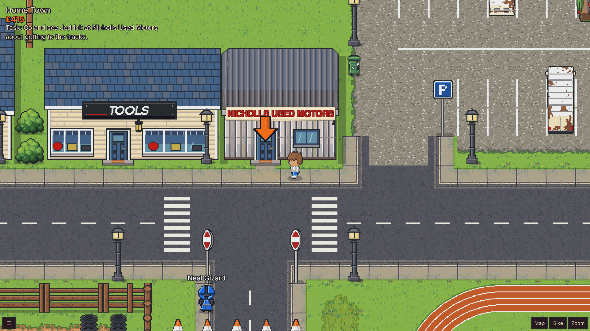
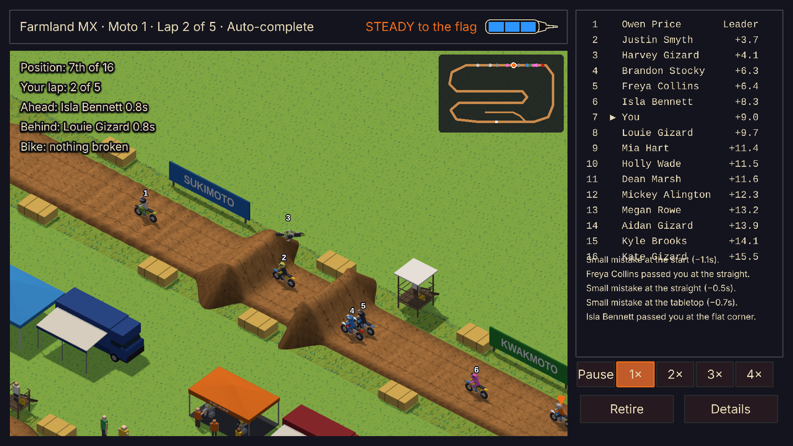

# Motocross RPG: The Road to Legend

A single-player, offline motocross career RPG. Start as an unknown rider with a broken 50cc and work your way up to legend.

| Home Town: the player outside Nicholls Used Motors | Race day at Farmland MX: a rider throwing a whip over the double |
| --- | --- |
|  |  |

This is **Alpha v1.1**: the whole career loop from a broken bike to race days at three venues, player-made tracks, and now the **Local Champion Championship** for the Area 1 badge. All art is placeholder art in the agreed style, imported from the project's art threads.

## A hobby project, offered as-is

This is a hobby project, made for fun in spare time. It is offered as-is, with no warranty, no support and no promised updates. There may be bugs, and some may never be fixed. Issues are turned off on this repository and I'm not able to answer questions, take requests or fix problems. You're welcome to play it, learn from it and change it for your own use under the terms of the [MIT license](LICENSE), at your own risk. Back up anything you care about: your career is saved in the browser you play in, so use **Load → Export save** now and then to keep a copy as a file, and keep copies of your own tracks (the `.track.json` files in `public/mods/tracks/`, or the editor's **Export**).

## What Alpha v1.1 offers

The game loop: **earn money, keep the bike going, race, level up, repeat.**

1. **Start a career** in Home Town with a broken 50cc. Paul Phoenix, the mechanic at Phoenix MX, gets it running in the tutorial and teaches the basics.
2. **Earn money** on shifts in the Industrial Zone: the fabrication shop (frame brackets) and the engine rebuilder (pistons). Pay is per part made, and is boosted 5× while testing.
3. **Look after the bike.** Every lap wears its parts, and a part at 0% breaks. Buy new or better-grade parts at Moto78 (the bike shop) and the tyre shop in Home Town (fitted free, or kept as spares in your bag), and pay the local garage to repair or fit them. On a shop's Sell tab, tick spares and use **Sell selected**, or **Sell all** (Boss, 31 Oct 2026).
4. **Get a van** and load your bike to reach the tracks on the venue road. On the Old Rusty Truck you can see it: your bike rides in the open bed in its brand colours, strapped down to the front of the bed (Boss, 30 Oct 2026).
5. **Race.** Three venues are open: **Farmland MX**, **Riverside Arena** and **Longmoor Enduro**, with Joseph Halden at the race office of each: his family runs every track in the land, and he introduces himself the first time you talk to him (Boss, 30 Oct 2026). A race day is two motos against 15 riders (5 laps a moto, or 8 at Longmoor Enduro, and 8 in a motocross or endurance championship round), including the Local Champion: £20 entry (your first race day is free), gate picks, a start official and a pit board, with prize money to 10th in each moto. Free practice is 25% of the entry, and the backyard loop at home is free.
6. **Win the badge.** After your first race day, enter the **Local Champion Championship** at any race office: three rounds, one at each track, against the same 16 riders, with points for every moto. Win it for the Area 1 badge. The six-round **Area 1 Championship** is listed but locked until Area 2 is ready (Boss, 29 Oct 2026); its prize money stays as it is until the game is further along.
7. **Level up.** Racing and practice train your Rider Ability skills, and better skills and better parts make you faster.
8. **Race your own tracks** with **Mod Tracks** on the venue road (see *Making and installing mod tracks* below).
9. **Bring your own 3D models** from Blender: swap the scenery, the race bike and the rider, or add new scenery (see *Your own 3D models* below).

It runs in a browser on desktop or on a phone held sideways, and saves automatically.

## Play it

- **In a browser:** once GitHub Pages is switched on (Settings > Pages > Source: GitHub Actions), every push to `main` publishes the game to this repo's Pages site. The v1.5 test build is published beside it at `/test-v1.5/` from the `test/v1.5` branch, with its own saves.
- **On your own computer:** install [Node.js](https://nodejs.org) (LTS), then:

  ```
  npm install
  npm run dev
  ```

  and open the address it prints (usually http://localhost:5173).

### Controls

| Action | Keyboard and mouse | Touch |
| --- | --- | --- |
| Walk | WASD or arrow keys, or click where you want to go | Tap where you want to go |
| Talk to an NPC or use an object | Click it, or face it and press E or Space | Tap it |
| Next line of dialogue | Click, E, Space or Enter | Tap the box |
| Zoom (50% to 200%) | Mouse wheel, + and -, or the on-screen zoom control | The on-screen zoom control: a Zoom button with a slider, or + and − buttons (Settings > Display > Zoom control) |
| Bike, bag and current task | Tab, I or B | Bike button |
| Skills | K, or the Skills tab in the Bike panel | Bike button, then Skills |
| A skill's XP and the XP for its next level | Hover over the skill on the Skills tab | Tap the skill; tap empty space to hide it |
| Pause menu (save, settings) | Esc | ☰ button |

### Playing on a phone

Hold the phone sideways: the game is laid out for landscape, and asks you to turn the phone if it is upright. For the most room, use the browser's Add to Home Screen: the game then opens full screen with no browser bars. The game draws at the phone's full screen resolution, and panels shrink to fit a short screen.

### Backing up and moving your career

Your career is saved in the browser you play in, so another browser or device starts empty. **Load → Export save** gives you your career as a file (`mxrpg-<rider>-<date>.save.json`): a download on a computer, the share sheet on a phone or tablet (Save to Files on iPhone and iPad, Drive or Downloads on Android). **Load → Import save** on any browser or device picks that file and carries on the career there; Load is open even with no career saved, for this. Importing over a career keeps the one it replaces as Backup 1 under Load. A save from an older build is upgraded on import like any other; one from a newer build, or a damaged one, is refused with the reason. Export now and then as a backup: Safari can clear a website's storage after about a week without a visit (a Home Screen app is not affected). The code is in `src/core/saves.ts` (the file format) and `src/ui/files.ts`.

**Old saves and v1.5** (Boss, 30 Oct 2026). Careers saved before v1.5 don't carry over: the venues are now one map per track type (`venue-motocross`, `venue-supercross`, `venue-enduro`) and the old venue maps are gone, so a save from Alpha v1.1 or an earlier v1.5 test build may load in the wrong place or not at all. Start a new career for v1.5. This is an Alpha, and old saves aren't kept working between test versions.

## Making and installing mod tracks

Mod tracks are race tracks made with the game's track editor and raced in the game from **Mod Tracks** on the venue road. A mod race day plays exactly like Farmland MX: the same entry fee, field, AI riders, prize money, XP and parts wear. Picking a mod track goes straight to the gate pick, without a venue area to walk round, and race day is the only mode (no practice): that is how mod tracks stay (Boss, 29 Oct 2026), with no modders' town area planned.

**1. Build the track** on a computer: the track editor needs a mouse and keyboard and isn't usable on a phone (racing mod tracks on a phone works, through Import track file). Open the track editor: `tools/track-editor.html` on the published site, or http://localhost:5173/tools/track-editor.html when running `npm run dev`. Choose **New**, draw the route, then add:

- a **start straight**, which needs its own gate and must join the lap;
- a **finish line**;
- a **start board official**, with a walk that ends clear of the track.

Then use **Ready to race**, which runs the game's checks.

**2. Save it.** The editor opens on the mod tracks: the example in `public/mods/tracks/` and any saved there; the game's own four tracks are not listed (the Development edition has a **Show the game's own tracks** tick under the list, remembered in the browser, for working on the game itself). Tracks made with **New**, **Duplicate** or **Import** are mod tracks. The first **Save** asks for the track's name, and the track is saved as its own file, `public/mods/tracks/<name>.track.json`, never into the game's `tracks.json`. It can't overwrite another track: a name already in use is refused.

- With `npm run dev`, use the track editor at http://localhost:5173/tools/track-editor.html and **Load the tracks from this server**. Save then writes straight into `public/mods/tracks/`, and the game picks the track up on its next page load. Saved mod tracks are listed in the editor too, to carry on editing.
- If you **Open folder…** on the project in Chrome or Edge, Save writes into the `public/mods/tracks/` folder there.
- Anywhere else, Save downloads the file for you to put in `public/mods/tracks/`.
- **Autosave** (the tick by Save) saves your changes every two minutes without asking, wherever Save could write quietly: mod tracks through the dev server or into the opened folder. A new track needs its name from Save first, and a download-only setup still needs Save.

**Export** still saves any track as a `.track.json` to share.

**3. Race it.** On your own copy, a track in `public/mods/tracks/` shows under **Mod Tracks** in the game. For a built copy, rebuild with `npm run build`, because the build writes the folder's `index.json` (a website can't list a folder by itself). With `npm run dev`, **Race it in the game** in the editor opens a race day on a saved mod track straight away. On any copy, including the published site, you can also use **Mod Track → Import track file** in the game to pick a `.track.json` from your device. It is kept in that browser only, and can be removed from its race office. `farmland-example.track.json` is in the folder as an example.

**What a mod track must meet.** The game runs the same checks as on its own tracks:

- it is a track file from the editor (or a bare track), and is not marked as an unfinished draft;
- it is not practice-only;
- it has a start straight with its gate, long enough and joined onto the lap;
- every section type is one the game knows;
- it uses only the game's own surfaces, ground and scenery (custom art isn't supported yet);
- the start official stands and walks clear of the track, the line-up and solid scenery.

**Enduro Sprint tracks (Boss, 29 Oct 2026).** Set the track's Kind to **Enduro Sprint** for a point-to-point timed test instead of a loop. There is no start gate or start straight: riders leave the start line one at a time, 10 seconds apart, and can catch and pass the rider in front. After the finish line they roll down a single-file **return lane** (a quarter of the track's width, at half speed, no passing) and queue at the start for the next lap. The return lane's time is left out, and the lowest total time over the timed laps wins. A one-lap timed qualifying sprint sets moto 1's start order (fastest first), and moto 2 goes in moto 1's order. Sprint motos are 8 laps (`kindLaps` in `racing.json`). In the editor, place the finish line, then use **Start line** to lay the return lane from the finish to the start; the track's checks then ask for:

- the return lane as the first section, at least 20 grid units long, kept clear of the test except at its ends;
- no start straight and no start board official;
- the sprint start (an arch with a timing beam, a clock, a timekeeper with a stopwatch and a scorer with a clipboard) on the start line, which is added for you if it's left out.

Enduro sections that any mod track can use: **rocks**, **logs**, **log step**, **water crossing**, **roots**, **off-camber**, **hill climb** and **woods**, with **boulder** and **log pile** scenery. Endurocross obstacles (Boss, 1 Nov 2026), for sprints, cross and endurance races alike: **concrete pipe** (one big pipe across the track, mud packed up its sides), **tyre bed** (tractor tyres on their sides over the whole section), **tyre wall** (two rows of upright machinery tyres packed with mud) and **log stack** (two 3-2-1 log triangles, up and over). The rock garden is rock edge to edge, and cut rounds fill the gaps between the logs of a log crossing. Through rough going riders wander: in on one line, out on another, or across and back. The example sprint is **Quarry Sprint** (`public/mods/tracks/quarry-sprint.track.json`). Mod tracks could use it first (Boss, 29 Oct 2026); the game's own sprints are in Areas 5 to 8 (Boss, 4 Nov 2026).

**No-Turn Takedown tracks (Boss, 30 Oct 2026).** Set the track's Kind to **No-Turn Takedown** for a straight drag strip on a long, slim **200 × 30** grid (half the motocross grid's short side by twice its long side). There are no bends or corners anywhere: the editor never lets you draw the route by hand. Pick **Start platform** under Start and finish and click where the start line goes; the run goes straight on from there to the finish line, and **+ Straight** / **− Straight** make it longer or shorter, 10 grid units at a time. Jumps, whoops, rhythm and the rest go on the run as features (no corner features), and a tabletop or double at the end of the run can be the finish line, with the finish arch over it, as on a supercross track. Past the finish line is a short **run-off** where riders pull up (the first section); the way back from it to the start is never drawn or ridden. The start is a **raised platform** with four gates, two each side of the **starter's box**, and riders drop down a short hill onto the run, with no first corner.

A No-Turn Takedown race day is a **knockout of 32 riders**: everyone rides a timed **seeding run** on their own, 8 seconds apart. You go second, so only one rider is ahead of you, and once you have your time the rest of the field's runs are done off screen and the bracket comes up with your time and seed (Boss, 31 Oct 2026). There is no Auto Race on this track type, as every run is a single short one; the seeding times split the field into **heats of four**, the fastest kept apart, and the **first two** in each heat go through (32 → 16 → 8 → 4). The heats are drawn up as a fixed **bracket**, two-sided like a printed tournament bracket with the final in the middle (Boss, 30 Oct 2026): each heat's first two go on to the box beside it in the next round, and seeds 1 and 2 start on opposite sides, so they can only meet in the final. The starter's box between the gates on the heat screen is a plain black box. The **final** is the best of three runs: each run scores its place (1 for a win, 4 for last) and the lowest total wins, the last run breaking a tie. Riders out earlier are placed by the round they went out in, then their place in their heat, then their seeding time. Prize money is two motos' worth at your overall place plus the podium bonus. The rules are `sim.knockout` in `racing.json`. The CPU riders' own heats are run for you between yours. It is **late-game content**, balanced to be as hard to win as a race day at the same level (Boss, 30 Oct 2026): the field is the **31 best riders** in the pool, raced **50% better** (skills and bike condition, `buff`), and a run rides with a fifth of the usual luck (`noise` 0.2) because it is only a few sections long, so skill counts as much as over a moto's laps. Measured over 300 days on a bike at 90% (`npx vite-node tools/sim/knockout.ts`), a rider wins it about as often as a Farmland race day: knockout 0% / race day 0% at rider level 1, 1–3% / 1% at level 10, 12% / 9–11% at 15 and 37–40% / 25–35% at 20. Getting on the podium is a little harder than at a race day, as you have to reach the final. The pool is the Area 1 rider pool, now 50 riders: 21 of them (`cpu.r30` to `cpu.r50` in `riders.json`) are placeholders added for the knockout, to be replaced with real riders later. The example is **Takedown Strip** (`public/mods/tracks/takedown-strip.track.json`). It was for mod tracks only at first (Boss, 30 Oct 2026); the game's own strips are in Areas 6 to 8 (Boss, 4 Nov 2026).

**Supercross nights (Boss, 1 Nov 2026).** Every Supercross race day and championship round, at every stadium track in every area (Riverside Arena too), runs the **AMA night programme** with no qualifying. **32 riders** (31 CPU riders and you) are drawn at random into **two heats of 16**: the **first 6** in each heat go through to the **Main Event**, the **last 2 go home**, and the rest (8 from each heat) ride the **LCQ** (Last Chance Qualifier), whose **first 4** make the Main. You are drawn into Heat 1 or Heat 2, and the other heat (and the LCQ, if you went straight through) is run off screen and its results shown. Heats pick gates in a random draw; the LCQ in heat finishing order; the Main gives the heat winners first pick, then the heats' 2nds and so on, with the LCQ's four last (a tie goes to the faster race time). Heats are 4 laps, the LCQ 3 and the Main 8 (`sim.supercross` in `racing.json`). **Only the Main pays and scores**, and it is worth a whole race day: two motos' prize money at your Main finish plus the podium bonus, and in a championship two motos' points (Boss, 1 Nov 2026). Knocked out in a heat or the LCQ, your night ends with no prize or points and the entry fee gone, but you keep the XP and the wear from what you rode. **Leave early** is there between races (it counts as not making the Main). **Between races you can repair at the track** with your own tools: Bike check has a Repair button on each part your tools cover, free, back to 100% and one grade down as at home. A championship's Supercross round races its own riders plus enough of the area's other riders (buffed like the rest) to make 32. The rules are `src/core/supercross.ts`.

**Move whole track** (any Kind) picks the whole track up as one piece in the editor and drops it somewhere else on the grid, with its start, features, scenery, ground paint and heights.

A track that fails stays in the list, and picking it shows the reasons. An import that fails isn't added. Each track is listed by its name, with its file name under it. Mod tracks get their own ids, so they never clash with the game's tracks. The code is in `src/core/modTracks.ts`.

## Your own 3D models (Blender)

Every object in the race view can be swapped for your own model, and new scenery added (Boss, 31 Oct 2026). From v2.0 Boss's models are the game's own, built-in models for nearly every object (93 `.glb` files in `public/assets/models/`: the race bikes and rider, the 50cc mini, pit bike, enduro and vintage twin-shock bikes on stands (Boss, 3 Nov 2026), marshals, flag men and pit crews, the paddock vehicles, the finish arches, the TV crews, stands and crowds, and the trackside and pit scenery; Boss, 2 Nov 2026), and the old objects built from boxes in code that they replaced are gone. Still built in code: the start gate and sprint start (they stretch to the track), the skip (Boss kept the game's own),  the start official's box, the stands' and moving figures' frames the models' parts are fitted to, and the race bike the game builds if its model is missing. An item whose model is missing shows as a plain box. `public/mods/models/` is now empty, for your own models, which replace the game's own of the same name. Open **Models** from the toolkit (or the track editor's **Models…** button, or the game with `?models`), pick an object and **Export** it as a `.glb`. Open it in Blender, change it, export it as glTF Binary into `public/mods/models/`, and reload. A file named after a scenery item (`hay_bale.glb`) replaces it on every track; `race_bike.glb`, `race_bike_youth.glb` and `race_rider.glb` replace the race bike and rider (and `sidecar.glb` is every outfit in a sidecar race; `stand_pallet.glb`, `stand_tower.glb`, `stand_bales.glb` and `pit_wall.glb` are the marshals', flag men's and pit crews' stands for each design, in the item's colour through materials named Team and TeamDark, Boss, 1 Nov 2026; and `paddock_stand.glb` is the stand under every bike on a stand (the item, and those under awnings and in pit tents), which then carries your race bike in the item's design and colour), painted in each rider's colours through materials named Plastics, Frame, Plate, Helmet, Jersey and so on; any other name becomes a new item in the track editor's Scenery palette. The solo rider moves on the bike (Boss, 3 Nov 2026): Boss's rider model carries poses built from real riding references, which the race blends as riders go round, stood up in the attack position over bumps and whoops, sat with the inside leg out through slow corners, leaning in stood up on berms and fast corners, back on the brakes, forward on the gas, compressed into a jump, neutral in the air, soaking up the landing, feet down at the gate and sat back in a wheelie (`src/core/riderPose.ts`). The marshals, flag man, pit crews, fans and start official take a model part by part: name the parts in Blender (Body, Arm, LegL and so on, origins on their joints) and the game moves them as it moves its own (Boss, 31 Oct 2026). A scenery model can also carry its own animation, which plays on a loop. Parts named **Track** follow one rider a lap, picked at random, as they go by (TV cameras, photographers; Boss, 3 Nov 2026, so a camera no longer swings between riders in a group), **Flash** blinks as a rider passes (camera flashes), and **Drone** flies off after a random rider as the field comes by and returns to its pilot for the next pass. In a stand or crowd, each **Cheer** section is given a rider at random each lap and stands up only as that rider goes by, and **Supporter** fans dotted through different sections jump up for the same few favourite riders, in place of the Mexican wave (Boss, 1 and 2 Nov 2026). The start gate and sprint start stretch to fit the track, so they stay as they are; the finish arch takes `finish_arch_mx.glb` and `finish_arch_sx.glb`, built in parts the game moves out and stretches to the track's width (Boss, 1 Nov 2026). A model that breaks a rule is skipped (the game's own model shows) and the Models page says why. The rules for each type (size, triangles, ground, facing, colour slots) are in [docs/MODELS.md](docs/MODELS.md); the code is `src/core/modModels.ts`, `src/world/modModels.ts` and `src/scenes/ModelsScene.ts`. Banners and sponsor boards show the words typed for them, or a PNG of your own picked in the track editor under **Picture** from `public/mods/banners/` (best 2000 × 200 pixels for a banner, 1200 × 260 for a sponsor board; an example of each is there; Boss, 1 Nov 2026); a banner or board model shows them on its material named Text. Every other item with its own words takes a picture the same way, on the game's own item and on a model's Text material: feather flags (tall, 200 × 1000; a wide picture is turned to read upwards there, as the words are), the sponsor inflatable, the finish arch, the sprint start, the podium, holeshot board and stadium tunnel, and the tents', vans' and stands' name boards (Boss, 2 Nov 2026; the sizes are in that folder's README.txt and the Picture box).

## Areas 2 to 8 build (test branches `areas/task-NN`)

Built from `docs/AREAS_2_TO_8_PLAN.md` on a chain of branches, each starting from the one before. What each task added:

- **Released one area at a time (Boss, 1 Nov 2026).** v1.5 releases Areas 1 and 2: `release.lastArea` in `areas.json` is 2. You can win every championship, but winning the Area 2 Championship opens nothing. Manny Festo, in Home Town and Mountain Town, then says Area 3 (Beach Town) is due in February 2027. A later build raises `lastArea`, and a save that has already won the way in opens the next area when it loads.

- **Each house has its own inside (Boss, 1 Nov 2026).** From Area 3, every house is bigger and better furnished than the last. The Semi with garage has a garage with the bike, and the Detached house adds a study and a workshop corner. The Farmhouse has two bedrooms and a boot room, the City estate a bar, home gym and office, and the Champion's estate a full workshop and its own wing for the trophy and bike display room. Every seat faces the TV. Each house keeps the wardrobe and storage chest. They're drawn with the art folder's interior generator by `house_interiors.py` (project files, `areas-2-8/tools/`).
- **Beach Town's shops have their own insides (Boss, 3 Nov 2026: "i want Area 3 completed").** Phoenix MX, Moto78, Lee's T's & Wheels, the Brake works, the Town house and Nicholls Used Motors are no longer Home Town copies. They use a new seaside interior set: whitewashed boards, blue and white tiles, sandstone flags and a blue resin workshop floor, sea-green and duck-egg walls, portholes, lifebuoys, a ship's wheel, nets, surfboards, palms and wicker chairs. The Brake works has its own machines for the shift: **turn the disc** at the disc lathe, **bore the caliper** at the caliper borer and **fit the pads and bleed** at the bleed bench (`job.a3.brakes`). Lee's has a brake counter, since he sells brakes in Beach Town. Paul and the Brake works boss stand in new spots. The insides are drawn by `area3_interiors.py` (project files, `areas-2-8/tools/`) and are Tiled maps in the art folder, so `gen-area.mjs` no longer stamps any Area 3 map.
- **Every Area 2 and 3 drill has its own picture (Boss, 3 Nov 2026: "all the fitness ones need different graphics like for the weights, not all doing pushups").** The drill screen now shows what you're training, in your own outfit and on your own bike: **Weight training** is the bench press under the rack (a clean lift lowers the bar and presses it back up, a miss stalls half way), **Body position** rides a line of bumps and stands you up in the attack position for a good press, **Cone braking** goes down a line of cones side on (on pace you brake square at each one, too hot and the bike dives), **Rut riding** brings a rut in to the front wheel (drop in, wash out early or cross-rut late), the **agility ladder** is a run up and down the ladder on the gym floor, **Jump timing** is a tabletop taken off the lip (clean, cased or overjumped) and **Whoops and sand** skims or drops into the Beach Town whoops. The timing of each game and its XP are unchanged, and Area 1 keeps its push-ups, gate and running track. The new rider frames (bench press, and on the bike seated, attack and low) are made from each outfit by the art folder's `characters/tools/make_exercises.py`, and a drill picks its picture with `scene` in `training.json`.
- **Areas 2 and 3 have their own ten tracks (Boss, 3 Nov 2026: "create all 10 tracks the 5 for area 2 and 5 for area 3. I can touch them up if needed").** The placeholder copies of the Area 1 tracks are gone. Mountain Town: **Clayhill MX** (about 910 m of hard pack, with an uphill, a ski jump and a rhythm), **Valley Arena** (a 495 m supercross lap), **Bog End Enduro** (1.5 km of loam with mud, roots, logs and water crossings), **Kyle's mountain loop** (hills and off cambers) and **Freya's pond track** (loam, round a pond). Beach Town: **Dune Park MX** (940 m of sand with whoops, a step down and a triple), **Pier Arena** (a 396 m supercross lap), **Shoreline Enduro** (1.55 km of sand, with rocks, a hill climb and a water crossing), **Owen's dune loop** and **Callum's beach strip** along the sea. Each keeps its id, name, gates and race type, has its own start straight, ground painting, patches of mud, sand or ruts, and scenery, and passes every track check. `trackParts.json` adds four ground tiles for them: dry sand, wet sand, pond water and sea. They're first drafts for Boss to touch up in the track editor. Two rider AI fixes came with them: the small lift riders get over rocks, roots and tyre beds now fades in and out at a section's ends, and the tests count rocks, roots, logs, pipes and tyre walls as sections a rider may leave the ground on (`JUMPY` in `tests/raceHelpers.ts`).
- **Area 5 is Western Works (Boss, 4 Nov 2026: "lets changes it's name everywhere to Western Works").** Northern Works is renamed everywhere: its map (`area5-western-works`), tiles, signs, dialogue, the sponsor (Western Dirt) and the art folder's Tiled maps and tools. Saves move to version 8, and a save standing in the old map is moved to the new one.
- **Forest Town and Western Works have their own insides (Boss, 4 Nov 2026).** Their six shops each (Phoenix MX, Moto78, Lee's, J's Tools, the works and the town house) are no longer Home Town copies. Forest Town's set has oak parquet, slate flags and pine boards, cuckoo clocks, trail maps, a wood stove and plaid armchairs, and the **Suspension shop** has its own stations for the shift: **service the forks** at the fork stand, **dyno the shock** and **fill and bleed** at the fill bench (`job.a4.works`). Western Works has brick, steel tread plate and quarry tiles, enamel signs, gauges, a chain hoist and iron radiators, and the **Frame works** has a **frame jig**, a **TIG station** and an **anvil** for dressing the frame (`job.a5.frame`). They're drawn by `area4_interiors.py` and `area5_interiors.py` (project files, `areas-2-8/tools/`) and are Tiled maps in the art folder.
- **Forest Town's and Western Works' stories (Boss, 4 Nov 2026).** Each intro now runs like Beach Town's: Manny's news, Paul, Lee, the works boss, **one pass of the works shift**, a round at the fitness venue (**yoga** by the pond in Forest Town, **rowing** in Western Works), the yard coach, then the Local Champion. Each town has a coach with their own storyline after its intro: **Gus Fernley** in Forest Town (a round of berm and flat corner and one of ruts over roots, his story of the Borne kids learning in these woods, then a Grade 5 shock) and **Vera Flint** in Western Works (rock garden, shadow passing, her story, then a Grade 6 set of wheels and tyres). Four new NPC sprites: the yoga teacher, Gus, the rowing coach and Vera. Both names are placeholders.
- **Every Area 4 and 5 drill has its own picture (Boss, 4 Nov 2026), drawn like the Area 2 and 3 ones (Boss, 4 Nov 2026: "your art work from area 2 is prefered").** The riding drills use the Area 2 and 3 pictures' sky, rolling hill and dirt, with the player on their own bike and the coach standing by. Forest Town's hill is a deeper green with a soft line of round treetops and a tree at each side; Western Works' hill is a dry olive green with the works on its crest, a brick shed with a saw-tooth roof and two smoking chimneys. **Ruts over roots** and **Rock garden** bring a twisting root or a grey rock in to the front wheel over leaves or gravel going by (over it, deflected or stalled, or the bash plate hit with sparks). **Berm and flat corner** rides up the berm's face and roosts out of it, and brakes at the flag for the flat turn. **Shadow passing** follows a pro in the champion's kit, on another brand of bike on the far side of the line, and draws by at the end of each pass. **Yoga** is in a studio with a big window onto the woods and the ladder gym's wooden floor: the rider faces the front and flows warrior (arms out, legs wide), tree (hands up, a knee raised) and seated cross-legged, and a miss wobbles. **Rowing** is in the same gym as the bench press, with the stroke rate on the monitor. Each outfit's yoga poses are made from its front idle frame by the art folder's `characters/tools/make_exercises.py` (96 by 80 frames), and the rowing frames from its side frame, listed as `yoga` and `row` in the manifest.
- **The Area 6 and 7 drills have their own pictures, in the same style (Boss, 4 Nov 2026).** In the Highlands the backdrop is far blue mountains with snow on the tops over a heather hill: the **hill climb ride** is on a pedal bike in the bike's brand colour up a climbing road, seated and spinning on pace, stood up and swaying too hard, the pedals barely turning too easy, and **repetition laps** ride past a timing beam with a lap board listing the last three laps (on the time in green, a slower lap in orange and a twitch off line). In The City the **dojo** has pale wood walls, a scroll and tatami, and the rider strikes a heavy bag on its chain, punch, punch, kick, with the bag swinging for a clean strike and hanging still for a miss. **Supercross rhythm** is under the arena lights in front of the crowd: a clean take-off sails to the next landing, a miss cases it. **Drag launch** is on the No-Turn strip below the skyline: the ambers come on through the hold and the green at the moment, a good launch lifts the front and goes, a jumped start lights the red. The dojo's guard, punch and front kick are made from each outfit's side frame by `make_exercises.py` (96 by 72 frames, `dojo` in the manifest).
- **Areas 4 and 5 have their own ten tracks (Boss, 4 Nov 2026: "No i want new placeholder tracks").** Forest Town: **Rootwood MX** (686 m of loam through the pines, roots, a zig-zag down the right and a rhythm), **Timber Arena** (a 471 m supercross lap with a triple and a diagonal step-up), **Deep Forest Enduro** (1.36 km of roots, logs, woods, mud and a stream), **Isla's woodland loop** (a hooked inner section by a pond) and **Rhys's logging road** (fast gravel sweepers, logs across the road and a step down). Western Works: **Quarry MX** (836 m with stacked hairpins up the quarry benches, a long triple and a hill climb), **Foundry Arena** (a 359 m supercross lap shaped like the foundry roof, with a pipe and a tyre bed), **Slag Heap Enduro** (1.38 km over the slag heaps, rocks, a ford and mud), **Tilly's quarry floor** (concrete pads, a pipe and a tyre bed) and **Kian's canal bank** (a long run beside the canal). Each keeps its id, name, gates and race type and passes every track check. `trackParts.json` adds five ground tiles: forest floor, pine needles, quarry stone, slag and canal water. They're first drafts for Boss to touch up in the track editor.
- **The Highlands and The City have their own insides (Boss, 4 Nov 2026: "ok can you now do the same for are 6 and 7").** Their six shops each (Phoenix MX, Moto78, Lee's, the works, the Town house and Nicholls) are no longer Home Town copies. The Highlands set has grey flagstones, dark oak, a muted tartan carpet and slate resin, a glen window, antlers, a peat stove and tartan armchairs, and the **Gearbox works** has its own machines for the shift: **machine the shafts** at the shaft lathe, **build the cluster** at the gear press and **shim and test** on the gearbox rig (`job.a6.works`). The City has polished concrete, terrazzo, grey oak boards and black rubber floors, a skyline window, a neon sign, street art, a transit map, a coffee machine and a leather sofa, and the **Exhaust works** has a **pipe bender**, an **exhaust jig** and a **flow bench** (`job.a7.intake_exhaust`). They're drawn by `area6_interiors.py` and `area7_interiors.py` (project files, `areas-2-8/tools/`) and are Tiled maps in the art folder.
- **The Highlands' and The City's stories (Boss, 4 Nov 2026).** Each intro now runs like Forest Town's: Manny's news, Paul, Lee (moor tyres in the Highlands, supercross tyres in The City), the works boss, **one pass of the works shift**, a round at the fitness venue (a **hill climb ride** at the cycling club, a **dojo session** in The City), the yard coach, then the Local Champion. Each town has a coach with their own storyline after its intro: **Fraser Dunn** at the Hill practice track (a round of repetition laps, the story of Big Pete sending James Nestor up the hill after the sand, the same laps again into the wind, then a Grade 6 gearbox and chain that wants a service) and **Remi Castell** at the indoor arena (supercross rhythm, drag launch, the story of Harvey Borne learning indoors, then Grade 7 supercross forks). Four new NPC sprites: the cycling coach, Fraser, the sensei and Remi. The names are placeholders.
- **Areas 6 and 7 have their own ten tracks (Boss, 4 Nov 2026).** Highlands: **Ben Mor MX** (704 m on the hill's shoulder, a hill climb, a ski jump off the brow and a drop across the top), **Glen Arena** (a 523 m supercross serpentine of three long straights), **Moorland Enduro** (1.52 km of open moor: rocks, hill climbs, peat bogs and two fords), **Poppy's hill climb** (straight up the side, down a gully and back up it) and **Ethan's moor loop** (fast concrete sweepers round a lochan). The City: **City Edge MX** (855 m of wasteland with a tyre bed, a triple across the old car park and a step-up), **City Stadium** (a 461 m supercross lap with stands on three sides and a V down the middle), **Docklands Enduro** (1.7 km round the quays, dock basins, rubble, the timber yard and a spoil heap), **Niamh's car park sprint** (square concrete corners round a multi-storey's top deck) and **Finn's stadium car park** (wide sweepers round the stadium, with the stand in the middle). Each keeps its id, name, gates and race type and passes every track check. `trackParts.json` adds six ground tiles: moor grass, heather, peat, loch water, brick paving and dock water. They're first drafts for Boss to touch up in the track editor.
- **Capital has its own insides (Boss, 4 Nov 2026: "Can you now do the same for the last Area, Area 8").** Its six shops (Phoenix MX, Moto78, Lee's, the **Race department**, the Town house and Nicholls) are no longer Home Town copies: marble, herringbone parquet, a red carpet and a race-blue epoxy floor, a tall grand window, the national crest, portraits, a map of the Capital, a nationals poster, a telemetry wall, trophy shelves and a chesterfield. The Race department's shift has its own machines: **machine the part** at the CNC mill, **build it up** on the build stand and **dyno and sign off** on the engine dyno (`job.a8.works`). They're drawn by `area8_interiors.py` (project files, `areas-2-8/tools/`) and are Tiled maps in the art folder. The north-west road's arrival point moved one tile down so a motor can drive off it.
- **Capital's story (Boss, 4 Nov 2026).** The intro runs like the others: Manny's news, Paul, Lee, the works boss, **one pass of the works shift**, an **ice bath** at the recovery centre, the yard coach, then the Local Champion, who opens National MX, National Supercross and National Enduro. After it the national coach **Morgan Hale** has a storyline at the National training ground: pro jump timing, a pro gate drill, the story of how every Borne rode for Morgan's team and how Big Pete rang about you, then **Morgan's Grade 8 national team frame**. Two new NPC sprites: the recovery coach and Morgan. The names are placeholders.
- **Area 8 has its own five tracks (Boss, 4 Nov 2026).** **National MX** (781 m on the striped lawns below the palace: a big table, a long climb, a step-up and whoops into the last corners), **National Supercross** (a 399 m stadium lap with an M through the middle), **National Enduro** (1.46 km through the national park: roots, woods, a long hill climb, two fords, rocks, mud and a log stack), **Lola's national paddock** (a loop among the factory haulers) and **Archie's test track** (a long concrete straight for top speed, a chicane and a rhythm). Each keeps its id, name, gates and race type and passes every track check. `trackParts.json` adds striped lawn and parade gravel. They're first drafts for Boss to touch up in the track editor.
- **Enduro Sprint, EnduroCross and No-Turn Takedown open, with fifteen new tracks (Boss, 4 Nov 2026: "Area 5 2x Sprint Enduro; Area 6 2x Sprint Enduro, 1x No-Turn Takedown No Championship; Area 7 and Area 8 2x Sprint Enduro, 1x No-Turn Takedown, 2x EnduroCross").** The three race types no longer say Coming soon on the road menu: each has its own venue map at the Race Hub (`venue-enduro-sprint`, `venue-endurocross`, `venue-no-turn`), on every road out, with Joseph taking entries at the race office and a spot for the Factory Hauler (the sprint field gets a strip of gravel hardstanding for it). **EnduroCross** is a new track kind (`endurocross` in `trackParts.json`): a short indoor loop that fits on one screen like supercross, built from the endurocross obstacles, raced as two motos from the start gate, with the supercross finish arch and fireworks. Each track opens with its area's intro, races at its area's class against the area's field, and is a new track, not a copy. **Western Works:** **Slate Quarry Sprint** (a 1.17 km test through the quarry: rocks, a pond ford and the spoil ramp) and **Old Mill Sprint** (876 m round the mill yards: culvert pipes, tyre beds and the slag heaps). **Highlands:** **Glen Burn Sprint** (1.10 km over the burn three times and up the heather), **Heather Ridge Sprint** (1.13 km along the ridge, the drove road and a bog) and **Highland Strip** (a 405 m No-Turn run: rhythm, whoops, a triple, rollers and a table). **The City:** **Canal Towpath Sprint** (990 m of quays, the lock and the scrapyard), **Gasworks Sprint** (861 m round the gasworks yards and rubble), **City Takedown** (446 m: rollers, a dragon's back, whoops, a quad, rhythm and a table), **Warehouse EnduroCross** (472 m serpentine of four straights) and **Railyard EnduroCross** (416 m of hairpin legs through the sheds). **Capital:** **Royal Park Sprint** (1.0 km of lawns, the lake and the wood), **Common Woods Sprint** (929 m of roots, logs, sand and bomb-hole water), **National Takedown** (481 m: a step-up, whoops, a dragon's back, a triple, the long rhythm and a table), **National EnduroCross** (385 m, a V into the middle) and **Capital Dome EnduroCross** (372 m, a zig-zag of tyres and pipes). Sprint lengths are the timed test, without the return lane. The Sprints and EnduroCross tracks are raced in championships since the championship overhaul (below). The No-Turn Takedowns are race days only, with no championship and no free practice (a run is one short drop off the platform, so there are no laps to practise, as with mod tracks). They're first drafts for Boss to touch up in the track editor.
- **Beach Town's story and Big Pete's storyline (Boss, 3 Nov 2026).** Arriving in Beach Town, Manny tells you what's in town, Paul sends a parts order to Lee, who talks sand tyres and his new brake counter, and the Brake works boss shows you the job. Then you **work one pass at the Brake works** (disc lathe, caliper borer, bleed bench), **run a round on the beach agility ladder**, meet **Big Pete** at his sand track (from then on he's at every venue too), and Jonah Pike opens the tracks. Big Pete's own chain follows: a round of **Jump timing** and a round of **Whoops and sand** on his track, his story (Aidan Borne learned on this sand, and James Nestor is his son), then he watches you at the **Motocross Venue** and teaches **whips (Rider Ability 30) and scrubs (60)**. A story step can now be a finished drill round at a training spot or a finished pass of a shift, and the task markers point to the spot or the start bench.

- **Task 01: batch jobs train Mechanical Engineer, and the boss gives you a part** (Spec 15, Boss 30 Oct 2026). The fabrication shift is a batch of 50 brackets and the engine shift 100 pistons (Spec 15.5). Every pass through the stations gives XP in the skills it uses (cutting and grinding: Bodywork; welding: Welding; cleaning and test fitting: Engine Components, with Engine Assembly on the test fit; the lathe: Machining), at Tier 1's 3,000 to 6,000 XP an hour. One job is open per facility at a time: stop whenever you like, go racing, and the start bench offers to carry on from where you left off (`career.jobs` in the save). A finished batch gives you one new part of your class from the employer (`keeps` in `world.json`: a bodywork and controls part at the fabrication shop, a top end at the engine rebuilder) at a grade rolled from your Mechanical Engineer level and the facility (Spec 15.3: Grade 1 to 2 nearly always at level 1, Grade 10 at 1 in 100,000 at level 99). Once every Mechanical Engineer skill is 80 or more, a pass has a 4% chance of making two parts. The engine rebuilder tells you about the kept part the first time you meet him in the tutorial.

- **Task 02: every bike class, and the class milestone** (GDD 6.4, 8.1; Spec 12.1, 14.2, 18.3). `bikes.json` lists all eleven classes in order, 50cc to 60+ Vets, each with its Rider Ability unlock level and a provisional stat ceiling; `racing.json` has each class's laps and entry fee from the Spec (endurance and sprint races at twice the class laps, with 50cc keeping its 8), and `shops.json` prices parts by class id. A venue's class is now a minimum: a bigger bike races there in its own class, with every CPU rider on the same class of bike, and a smaller bike can't enter. The **Area 1 Championship is the 65cc milestone** (`milestone` in `championships.json`): its first win sets `milestone.65cc`, and once Rider Ability is 10 you collect the bike at **Moto78's New bike tab**: the champion's sponsor offers a stock bike of their brand for nothing, or you buy a stock Grade 1 bike of any brand at the price of its parts. The old bike retires as it is (`career.retired`), spares for it stay in the bag to sell, and `class.65cc` is set. The Task tab points you to Bill once the trophy is yours. The championship itself still waits for Area 2 (`area2.ready`), which comes in task 05.

- **Task 03: J's Tools, DIY repairs, stock frames, Lee Stocky** (Spec 8.5, 17.2a; Boss, 30 Oct 2026). The tool shop is **J's Tools**, run by **Jason Styles** (the same Jason who races in the Area 1 pool; his sprite is a placeholder until his own is drawn). It sells four **tool sets**, one per part group, in three versions each (`tools.json`): bodywork tools from Area 1 at £300 (repairs up to Grade 3), wheel and brake tools from Area 2 at £600 (Grade 4), engine tools from Area 3 at £3,000 (Grade 5) and suspension tools from Area 4 at £1,500 (Grade 5), with Pro and Master versions in later areas up to Grade 9. A set is bought once and lasts for good; a better version replaces the one below. With the right set you **repair and fit parts yourself** for nothing at the **red tool cabinet in your room** or with **Work on the bike** at the back of your motor: repairs drop a grade as always, up to the set's grade, and give Mechanical Engineer XP in the set's skill (`career.tools` in the save). Grade 10 parts always go to Phoenix MX. **Moto78 now sells a stock Grade 1 frame** of your brand for every unlocked class (£400 for a 50cc), so a broken frame is no longer a dead end. The tyre shop is **Lee's T's & Wheels**, run by **Lee Stocky**, the ex Area Champion back from injury, now level 13 in the rider pool.

- **Task 04: the gate drop drill and the Phoenix MX job board** (Spec 3.2, 14.5a; Areas 2 to 8 plan gaps 2 and 5; Boss, 30 Oct 2026). The **backyard loop** now offers a choice: ride laps as before, or the **Gate drop drill** for Starts (`training.json`, `venue: "backyard"`). Your front wheel sits at the gate; it holds for a random 1.5 to 4.5 seconds, then drops, and you press Space or tap the moment it goes. A press before the drop is a jumped start, within 320 ms a good one, later a slow one; the window only widens from Starts 70 on, as if the gate dropped slower. Like every drill it is a 40 second round that can't be failed: 50 Starts XP whatever the score. The **job board on the garage wall** (`jobboard.json`) now holds three **customer repair tickets** at a time: a customer's part at a grade from 1 to 3, paying £10 to £25. A ticket plays like a shift on the garage stations (bike on the stand, the bench, back on the stand, the engine stand to test), never a single click, and gives 10 XP at every station in the part's Mechanical Engineer skill. Each ticket **needs your own tool set for its part**, up to its grade (`tools.json`), so better tools open better-paying tickets. One ticket is open at a time: leave and the board offers to carry on. Finishing a ticket puts a new set of three on the board.

- **Task 05: the area framework and Area 2, Mountain Town** (Spec 10.5, 18.1, 18.2; Areas 2 to 8 plan; Boss, 30 and 31 Oct 2026). **Winning the Area 1 Championship now opens Area 2** (`opens` in `championships.json` sets `area.2.open`): Mountain Town appears under Areas on every road menu, reached from Home Town's venue road and the Race Hub lanes as on the world map, and the Area 1 badge line no longer waits for a later build. `areas.json` describes each area (its town map, rider field and level, house, motor, weather), and `tools/gen-area.mjs` **stamps a placeholder town** from the Home Town bake for every area with a `town` entry: the same five travelling shops with their own insides (Paul, Bill, Lee and Jedrick), the tool shop's slot as the area's batch facility, the rented room as the area's house, the running track as its fitness venue and the practice track as its drill yard, with West road and East road route exits. Boss's own Tiled towns replace these as they're drawn. **Arriving in Mountain Town starts its intro chain** (`chains` in `story.json`, played like the tutorial): Manny's news, Paul's clothing rack, a parts order up to Lee, the Wheel works boss, the gym coach, then **Cal Mercer, the Local Champion**, who opens the three tracks (Clayhill MX, Valley Arena and Bog End Enduro, 65cc, their own tracks since 3 Nov 2026), raced at the Motocross Venue, the Supercross Arena and the Enduro Venue like every track of their type. The **Mountain Town Local Champion Championship** gives the Area 2 badge and the **Area 2 Championship** against **Taylor Heart** is the 85cc small wheel milestone and opens Area 3. **Riders race to the track's area**: the Area 2 field rides at least at level 24 (`level` on a field in `riders.json`), Taylor and Cal keep their edge above it, and Area 1's field is unchanged. **Rain** (Spec 10.5): a Mountain Town race day is dry, overcast, light rain (4% slower, 1.3× mistakes) or heavy rain (10%, 1.8×), rolled from the day's seed and shown on the moto header. **The Wheel works** is a batch of 50 wheels at £1 each with Wheels XP and a kept wheel; the garage job board offers Grade 1 to 4 tickets; the **town gym** (weight training, Strength, Tier 2) and the **practice yard** (body position, cone braking, rut riding) are drill venues with no track; two **challengers, Kyle Brooks and Freya Collins**, each set a repair errand before their £80 challenge opens. The **Starter terrace** (£3,000) is bought at its door and unlocks the wardrobe flag, and **Jedrick sells the Old Rusty Van** (£2,500, old motor in part exchange). Moto78 in Home Town stays the class dealer for now.

- **Task 06: Areas 3 to 8, stamped and playable end to end** (Spec 18.1, 18.2; Areas 2 to 8 plan; Boss, 31 Oct 2026: "Create the Area map art for all areas 2-8… roads match up to connecting towns… as in the world map"). `areas.json` now describes **Beach Town (3), Forest Town (4), Western Works (5), Highlands (6), The City (7) and Capital (8)**, and `tools/gen-area.mjs` stamps each one from the Home Town bake with its own insides, as placeholders until Boss draws the towns in Tiled; its three tracks race at the hub's venue maps. **Each area opens when the one before it is won** (`opens` on every main championship, Area 8's has none) and starts an intro chain like Mountain Town's: Manny's news, Paul, a parts order to Lee, the area's works boss, a trainer, then the Local Champion who opens the tracks. In Beach Town the trainer is **Big Pete, the Rider Trainer**, and meeting him teaches whips (Rider Ability 30) and scrubs (60) (`rider_trainer_tricks`). **Big Pete** (Boss, 1 Nov 2026: bald, black, in his 50s, stubble) trained every champion, and his son **James Nestor** is the Area 6 Champion. Once you've met him he keeps his sand track and is also at **every venue, across the gate from Joseph**: talk to him for **coached practice**, twice the free practice fee for +25% practice XP. **The roads follow the world map**: each town's West and East roads lead to the towns it is joined to in the picture (Beach Town to Mountain Town and Forest Town, Forest Town on to Western Works, then Highlands, The City and Capital, whose north road comes back to Home Town), the Race Hub's lanes reach every open area, and each area has its own zone on the world map. Every area has its **batch facility** from the plan (Brake works, Suspension shop, Frame works at £2 a part, Gearbox works, Exhaust works, the Race department that keeps any part), a **fitness venue** (agility ladder, yoga, rowing, cycling, the dojo, the ice bath) and a **drill yard** with the plan's rider drills (jump timing, whoops and sand, berm and flat corner, ruts over roots, rock garden, shadow passing, repetition laps, supercross rhythm, drag launch, the Tier 5 drills), a Grade 1 to 4+ job board, **shops stocking the plan's grades and classes** (Grades 1 to 4 in Area 2 up to 4 to 8 in Area 8, never 9 or 10, each area adding the next class; Moto78's stock frames come at the shop's lowest grade, so they rise with the area; Moto78 sells engine, suspension, bodywork and frames in every area as in Area 1, Lee's the wheels, tyres and brakes, and Phoenix MX only repairs and fits; Boss, 31 Oct 2026), two **challengers** with repair errands first, a **house** at a rising price (£12,000 Semi with garage to the £2,000,000 Champion's estate) and, up to Area 6, **Jedrick's next motor** (MX Van Short £6,000 to the MX Sports Motorhome Long £60,000). **Champions:** a placeholder Local Champion per area (Jonah Pike, Rowan Ash, Mick Granger, Ailsa Burns, Dev Okafor, Max Sterling) and the Area Champions Boss named (Aidan Borne, Kate Borne, Louie Borne, James Nestor, Harvey Borne, Neal Borne), taken out of the Area 1 pool and racing from their own area to Area 8. **Fields rise by area** (level 32 in Area 3 to 72 in Area 8), each area's two champions sit above its field, and the badge classes climb 85cc small wheel, 85cc big wheel, 125cc Youth, 125cc, 250cc F and 450cc F, with the next class as each area's milestone. Weather odds per area (indoor The City is nearly always dry). Every area now has its own tracks (Areas 2 and 3, 3 Nov 2026; Areas 4 to 8, 4 Nov 2026), as first drafts for Boss to touch up. Still placeholders: the Area 8 milestone is the 40+ Vets bike, and the Farmhouse's three-badge condition, the Highlands plastics moulding job, energy drinks, sponsors, the Modifying Machine quest, the sports car and the Factory Hauler are not built.

- **Task 07: bike setup, Basic and Advanced** (Spec 8.0 to 8.3; Boss, 31 Oct 2026: the Basic view from Area 2, where rain first makes setup matter, the Advanced view from Area 5). Every race office from Area 2 on has a **Bike setup** choice. Five sliders sit over the part groups (`setup.json`): Suspension (soft to stiff, forks and shock), Engine response (smooth to sharp, the engine slots), Gearing (short to tall, the drivetrain), Brake balance (rear to front) and Tyre setup (hard to soft). A slider is **locked at the middle until a Grade 3 part sits in its group**, with the reason shown. The **Basic view** is four ready-made setups, Hard-pack, Jump track, Sand and Mud, each setting every open slider at once to about 80% of the best setting for its conditions; **Default** puts everything back in the middle. The **Advanced view** (Area 5 and Mechanical Engineer 15) sets each slider on its own, with 3 positions to Mechanical Engineer 14, then 5, 7, 9, 13 and 21 as the level rises (Spec 8.1). Every section type on a track belongs to a kind (starts, tight corners, fast sweepers, jumps, whoops, sand, mud) with a hidden ideal per slider: a spot-on slider is +1% on that section, a badly wrong one up to −4%, so the best whole-track setup is a compromise, and rain pulls every ideal halfway to the mud setup. The office shows the setup's effect on this track as section colours (green, grey, amber, red), and from Mechanical Engineer 20 as a number per lap. It only ever moves the player's own section times: the default setup and every CPU rider ride exactly as before, and the same seed still replays exactly. Setups save with the career and carry from track to track. Not built: saved named setups and venue storage (Spec 8.4), the per-section track-map colours on the race screen, and the later detail levels of Spec 8.3.

- **Task 08: part modifiers, the Modifying Machine and Mad Maggie's quest** (Spec 6; Areas 2 to 8 plan; Boss, 30 Oct 2026: one machine, in the Industrial Zone, fixed by a quest line that starts in Area 5, Mechanical Engineer 30 to fix it). The machine's owner is **Mad Maggie**, and her machine is dead until her quest is done. **When Area 5 opens**, after the Western Works intro, Manny Festo's news mentions her, the Frame works boss sends you for a **coil** from Forest Town's Suspension shop and a **valve** from Beach Town's Brake works, the Wheel works in Mountain Town lends two old test parts, and at **Mechanical Engineer 30** you fix the machine in the unit yourself. Maggie's first test goes as planned: part one vanishes ("whoops, forgot to tell you about that") and part two comes out at **Corners +1, Rough −1, Wet −1** and is yours. From then on the machine is open at Spec 6's rules (`modifiers.json`): a bag spare with **no modifiers yet, at 80% or better**, for **£20 at Grade 1, doubling every grade**; **one go in ten eats the part**, no rerolls; otherwise it comes back with **three modifiers** from its slot's pool (engine parts roll Starts, Straights, Mud, Sand, Corners; suspension Jumps, Whoops, Rough, Ruts, Corners; and so on, Spec 6.2), each from 1 to 5 at 45/30/15/8/2 and as likely bad as good. Modifiers add up by type across the fitted parts with diminishing returns (±1 is 0.7%, ±5 2.8%, ±10 4.3%, 6% at most) and change the time of their own sections, or every section when their condition holds (Wet in the rain, Mud in heavy rain, Hard-pack and Loose by the track's surface). They stay on a part through fitting, swapping, repairs and saves, show on the bike panel and bag, and shop parts never have any. Not built: modifiers from manufacturing (Spec 15.4), rare drops, and a Masterwork roll.

- **Task 09: the wardrobe, Phoenix MX's clothing rack and the house storage chest** (Spec 17; Areas 2 to 8 plan gaps 17 and 18; Boss, 30 Oct 2026). Every house from the Starter terrace on has a **wardrobe** and a **storage chest** inside (`house.json`). **Buying the Area 2 Starter terrace unlocks the wardrobe**, and with it the **clothing rack at Phoenix MX** in Mountain Town and every later town: talk to Paul there and choose the rack, where **MX race kit (£60)** and **MX kit without the helmet (£45, men's sizes only for now)** hang beside the parts. An outfit is bought into the wardrobe and put on there, changing how the rider looks about town and in the van, and the rider's own clothes are always in the wardrobe to change back into. The rack shows why something can't be bought (no wardrobe yet, not your size, owned already). The **chest** is the one shared storage every house reaches: 10 spare parts with one house and 10 more for each further house bought, with a part's modifiers kept; a lent errand part can't be put away, and a part only comes out when the bag has room. Not built: sponsor kits and the Super Event outfit (they need their sheets), and the house's tool slots.

- **Task 13: one venue per track type, Areas 2 to 8 aligned** (Boss, 30 Oct 2026, confirmed 31 Oct: "There will only be 1 default Venue for each Race Type"). The overnight build had stamped a venue map per area and track type (21 maps); they are gone. **Every track races at its type's venue map**: the Motocross Venue holds Farmland MX and the seven areas' MX tracks, the Supercross Arena the arenas and the Enduro Venue the loops (`tracks.json` venues keep their ids, `map` is the type's map; `core/guides.ts` `VENUE_MAPS`, and a content check refuses a venue on the wrong map). **The road menu lists every open track under its type by name** (Clayhill MX under Motocross once Area 2's Local Champion has opened it), and picking one records it for the venue (`career.venue`): the gate and Joseph's race office are for that track, and the office's **Other tracks** choice swaps to another track of the type that races there. A championship's next round on the road goes to its track the same way. The Race Hub's three venue maps are the only `venue-*` maps on the road (Enduro Sprint, EnduroCross and No-Turn Takedown keep theirs for later); the Factory Hauler parks at those three; the per-area race officials are gone (Joseph takes entries at all three); each **Area Champion waits in their town** beside the Local Champion; `tools/gen-area.mjs` stamps towns and insides only.
- **Task 12: the champion's kit** (Boss, 31 Oct 2026: in Areas 1 to 4 the champion's offer is the new class frame and a kit, no contract). Taking the champion's sponsor's free bike after an area championship up to Area 4 also hangs the **Champion's kit** in the wardrobe (`house.json` kit and the `champion_kit` outfit, never on the rack); put it on at the wardrobe like any outfit. From Area 5 the sponsor contracts take over, so no kit comes with the free bike there. The kit is gold and black with the number 1 (Boss, 1 Nov 2026), for men and women (`player-m-champion-kit`, `player-f-champion-kit`).
- **Task 11: the Factory Hauler and the sports car** (Boss, 31 Oct 2026: the hauler is never bought or driven). Once a factory team signs the rider, **the team brings the Factory Hauler to every venue**: it stands on its spot at all three venues (`vehicles.json` hauler, with room for 11 bikes, 400 parts and 120 tools), solid to the rider and the van, and clicking it opens the back (bag and spares) or the workbench. The rider's own motor still parks where it is left, off the hauler's tiles. With the bikes travelling with the team, **Jedrick Nicholls in the Capital sells the sports car**: £250,000 with the old motor in part exchange, factory riders only (`areas.json` motor `needs`). It is drawn with the Old Rusty Van's sheets until its art exists (`artOf`; a re-import makes its own entry from `art`). Not built: the hauler's room as real storage limits, and the champion's kit.
- **Task 10: sponsors and reputation, Sponsored Rides from Area 5** (Spec 16; Boss, 31 Oct 2026: the Areas 1 to 4 champion's bike offer stands on its own, proper contracts and the reputation table from Area 5). A hidden **reputation** score from 0 to 1,000 (`sponsors.json`) rises with every moto finish ((11 − position) × the day's weight: a local day ½, a Local Champion round 1, an area championship round 2), with championship wins (40 × weight) and with sponsor objectives met, and falls for objectives missed, leaving a sponsor (−50) or being dropped (−80). Every CPU rider has a fixed score (their level × 10), which makes the **Sponsors' secret table**; the rider's share of it sets the top tier on offer (top half T3, top fifth T4, top 5% T5). **Finishing a Local Champion or area championship opens an offer window** once Area 5 is open: 2 to 5 offers, more with reputation, from local shops (T1, £30 to £60 an objective, 6 race days) to factory teams (T5, £7,500 to £15,000, 20 days). There is **no signing bonus**: a sponsor pays only for objectives met. Each race day under contract sets **one or two objectives** (finish top N by tier, beat the area's champion, finish both motos, presentation with every part at 50% or better at sign-on), settled on the results screen; two missed in a row is a warning and three end the contract. A sponsor wants every fitted part at the tier's minimum grade (none for T1, Grade 2 for T2, up to Grade 7 for T5), and leaving early costs the tier's share of the cash they have paid, more with days left. **Sponsors** at any race office from Area 5 shows what sponsors think of you (the garage's ear-to-the-ground lines), the contract and today's objectives, the offers to sign, and the way out. Signing a factory team sets the factory flag. Not built: the Factory Hauler at every venue and the sports car (they need the flag and new art), sponsor kits, holeshot and fastest lap objectives, and the hacked secret table on the home PC.

## Sidecar racing (test v1.5, Boss, 1 Nov 2026)

Sidecars are coming as a class of their own, brought in late in the game: no new venues, they race only on Motocross tracks once unlocked, and they will open championships across the land for their class. **Players can't race them yet** (Boss, 1 Nov 2026: "Must remove the ability to test race the Sidecars, they will be enabled later"): the Farmland race office's test tick box is gone. They can ride in one, though: as **Ray Crispy's passenger** (below, Boss 4 Nov 2026). The racing itself is built and tested:

- Under `npm run dev` only, `?testtrack=farmland&sidecar` jumps straight into a TEST sidecar race: you on a sidecar against 7 others, two motos of the laps a 50cc races there. It is free and counts for nothing: no prize money or XP, no wear, no records (you borrow a stock outfit for the day).
- The start: 8 outfits, 4 on the front row and 4 on the back, each taking two gates. An outfit sits on an even gate (2, 4, 6, 8 in front, 10 to 16 behind) with its chair over the odd gate beside it, so only the even gates can be picked; the odd ones show "chair".
- An outfit never whips or scrubs, whatever its rider's skill, and never loops out at the gate. It stays flat through corners, and once clear of the gate it keeps its bike far enough from the left edge for the chair to stay on the track, with more room between outfits than between solo bikes.
- Boss's `sidecar.glb` in `public/assets/models/` is every outfit, painted in each team's colours (Plastics, Frame, Plate); without it the game draws its own bike with a chair.
- The crew: `sidecar_crew.glb` holds the rider and passenger together, two objects named **Rider** and **Passenger**, each with its origin at its hips, at most 8,000 triangles, in the team's gear (Helmet, Visor, Jersey, Pants, Boots, Gloves). In a left-hander the passenger hangs out over the chair, low and leaning out; in a right-hander they climb across over the back of the bike; the rider leans a little into each turn; and both tuck down and forward over the jumps (`crewPose` in `RaceView.ts`). A figure can carry its own poses as shape keys named **Left**, **Right** and **Jump** (the passenger hanging out over the chair, across on the back of the seat, crouched holding the grab rail; Boss's video and photos, 1 Nov 2026): the game blends them in instead of moving the whole figure. Without the file, sidecars carry the race rider and no passenger.

The rules are in `src/core/sidecar.ts` (gates, MX-only, the borrowed outfit), the `sidecar` class in `bikes.json` (`"sidecar": true`, after the solo ladder; no solo class moves up to it, and its unlock of 99 holds its place until Boss sets one) and `racing.json`, the `sidecar` option on `RaceDay` and `MotoSim`, and the director's sidecar mode in `riderAI.ts`. Tests: `tests/sidecar.test.ts`.

### Ray Crispy: riding in the chair (Boss, 4 Nov 2026)

**Ray Crispy** (old, bald on top with white hair at the sides, round glasses, a blue and yellow MX kit and no helmet) has won more sidecar championships than anyone, but the last few seasons his passengers keep getting hurt. Once Beach Town's intro is done he's by Big Pete's sand track; talk to him and he tells his story (`met.ray`). From then on he stands next to Big Pete at every **Motocross and Enduro venue** (never Supercross), and **you ride as his passenger**:

- **Sidecar race day** and **sidecar practice**: his outfit against 7 others (on Motocross and Endurance tracks, at the laps the venue's own class runs there). Ray rides, so the outfit's pace is his riding (the field's level plus 4) with your fitness.
- **No wear on your bike**: it's his outfit. **Entry and practice cost three times** the venue's solo fee, and **you keep half the prize money**.
- **Fitness XP instead of riding XP**: being a passenger is hard work, so the ride's XP goes into Strength, Endurance, Agility and Wellbeing, half as much again a skill as a solo ride gives a riding skill.
- **Sidecar championships**: the four **Sidecar Series** of the championship overhaul (below), entered and raced through Ray, never at the race office. They replaced the first one-an-area sidecar championships (Boss, 4 Nov 2026). Where a track is in more than one, Ray's menu lists them. One can run alongside a solo championship. A round races the series' own field and level wherever it is, Ray included. The winners take the series' Sidecar trophy and your half of the prize.

The rules are in `src/core/passenger.ts` (Ray's terms on his NPC entries in `npcs.json`, `sidecar`), the `passenger` option on `SidecarDay` in `raceDay.ts` and `sidecar: true` championships in `championships.json`. Tests: `tests/passenger.test.ts`.

### The championship overhaul (Boss, 4 Nov 2026)

Boss's championship planner sheet (every championship against every track, with how many times it races there) is now the game's championships: 35 in all. Rounds are the sheet's row totals, and every round, whatever the track type, scores on the same points table.

- **The Area Championships are named after bike parts**, and their trophies are shaped like them: the **Sprocket Cup** (Home Town), **Chain Cup** (Mountain Town), **Spark Plug Cup** (Beach Town), **Clutch Cup** (Forest Town), **Gearbox Cup** (Western Works), **Handlebar Cup** (Highlands), **Exhaust Cup** (The City) and **Crankshaft Cup** (Capital). The badges now carry a big 1 and the town's name on a ribbon instead of "AREA n" (Boss, 4 Nov 2026). Both are placeholder art from `tools/art/badge-area1.py` and `tools/art/trophy-part.py` until Boss draws his own.
- **Areas 5 to 8's Local and Area championships race the new tracks too**: Western Works' Local adds Slate Quarry Sprint (4 rounds) and the Gearbox Cup both sprints (8); the Highlands' both sprints (5 and 8); The City's both sprints and both EnduroCross tracks (7 and 10); and the Capital's Local races National MX, Supercross and Enduro twice each with its sprints and EnduroCross tracks (10), the Crankshaft Cup 12.
- **Each area's story opens a set of type championships across the areas open by then**: Beach Town's opens the MX, SX and Enduro Series (Areas 1 to 3, two rounds at each track) and a Sidecar Series (Areas 1 to 3 MX tracks, twice); Western Works' a Sprint Enduro Series (its two sprints, twice); the Highlands' MX, SX, Enduro and Sidecar Series (Areas 4 to 6, twice) and a Sprint Enduro Series (Areas 5 and 6); The City's MX, SX, Enduro and Sidecar Series (every track to Area 7, once), a Sprint Enduro Series (Areas 5 to 7) and an EnduroCross Series (its two, twice); and the Capital's the same up to Area 8, with the EnduroCross Series at all four EnduroCross tracks twice.
- **No champion to beat in a series**: its 15 riders are drawn at random from every area open by then (`drawFrom`), at the level of the area that opened it. You race it on your own bike, at your own class or bigger, so the whole field rides your class wherever the round is.
- **The Legends Championship** opens once you've won the Crankshaft Cup: 16 rounds, every area's MX track in order, then back to Home Town's Riverside Arena and through every SX track.
- **No-Turn Takedowns stay out of every championship**: they're their own special event (Boss, 4 Nov 2026).

The rules are in `src/core/championship.ts` (`drawFrom`, and a round's venue may race the championship's class or a smaller one) and `championships.json`. Tests: `tests/championshipOverhaul.test.ts`, which holds Boss's sheet row by row.

## What's new in Alpha v1.1

Older builds (Alpha v1 and the test builds) are in [docs/CHANGELOG.md](docs/CHANGELOG.md).

### Championships

Checked against the last open line of the "Starter career slice" checklist (Systems Specification section 22): the Local Champion championship (3 rounds, one per track, 16 riders with qualifying) awards the badge, and the main area championship (6 rounds) then unlocks.

- **Two championships** in a new content file, `championships.json` (checked at start-up): the **Local Champion Championship** (rounds at Farmland MX, Riverside Arena and Longmoor Enduro) and the **Area 1 Championship** (two rounds at each, in the same order), both 50cc (Spec 12.5, 18.6).
- **Entering.** Every race office has a **Championships** choice: enter one, see where you stand, **Race round N** when you're at the next round's track, or **Give it up** (Start again was taken out, since giving up and entering again does the same; Boss, 31 Oct 2026). Only one championship can be on at a time: finish or give up the one you're in to enter another. At the venues, the line under the map name shows the championship in progress (next round, where, and your place on points) instead of the task (Boss, 31 Oct 2026). The Local Champion one opens after your first race day; the Area 1 one needs the badge and waits for Area 2 (`area2.ready`, which nothing sets yet). Entering is free; each round is entered at its own track's race office, where **Local Champion round N** replaces the local race day while your next round is on there (Spec 18.6, 6C). There is no calendar, so a championship waits until you ride its next round.
- **The field.** 15 CPU riders drawn from the Area 1 pool (16 with you, on two rows of gates) when you enter, the same at every round. Each championship has a **main rider**, the one to beat and the best rider in it on skill (Boss, 28 Oct 2026): **Louis Jonez** (now level 15) is the Local Champion, and **Dean Marsh** is the placeholder Area 1 Champion. Dean stays out of the Local Championship; Louis races in both. Everyone else races **10% better** in a championship (skills and bike condition), set by `buff` in `championships.json`. Normal race days and challenges are unchanged.
- **No qualifying** (Boss, 2 Nov 2026; until then every round but a Supercross one opened with an out lap and 3 timed laps). A round runs like any race day: **moto 1's gate picks are drawn at random, moto 2's go in moto 1 finishing order**. A Supercross round runs the night's heats instead (Boss, 1 Nov 2026). Before anything is ridden (moto 1 of a race day, a sprint's qualifying, a challenge or a seeding run), **Pull out** goes back to the paddock as if you never entered: no entry fee, nothing recorded (Boss, 31 Oct 2026). Paid free practice is the same: stop riding before you finish a lap and no practice fee is taken (Boss, 1 Nov 2026).
- **Field of 16.** Championships race 16 riders on two rows of 8, the same start as a race day (Boss, 28 Oct 2026: it looks cleaner than 20 on three rows).
- **Motors stay on the road, on the left** (Boss, 28 Oct 2026). A motor's body keeps to the road, car parks, gravel and concrete; only its front or back (two tiles for the Factory Hauler) pokes over the pavement or grass to turn round (`kerbs` in vehicles.json). Two-lane roads are driven on the left: east in the top lane, west in the bottom one, north on the left, south on the right. Steering and click-to-drive keep to the lane and a U-turn swaps lanes; junctions, car parks and entrances shorter than 4 tiles have no lanes. Too long to turn round on a two-lane road, the hauler turns at junctions instead.
- **Vans are motors** (Boss, 28 Oct 2026). Everything said about the van says motor; the seller is Jedrick Nicholls in the Nicholls Used Motors building (its banner too; Boss, 29 Oct 2026). The designs are motor-1 to motor-7, with saves carried over (save version 6); the van models and art files keep their names (`art` on each design).
- **Area Champion by name.** The Area 1 Champion stands in Home Town next to Mickey Alington (Boss, 4 Nov 2026: he used to stand on the shared motocross venue map, so he turned up at every area's MX venue). He shows their rider's current name over their head (Dean Marsh for now, from `rider` in npcs.json) and says they're the current Area Champion.
- **Dan Smyth** is an old bald racer with the Farmland track official's white beard, in an orange and black kit with no helmet (`tools/art` character script in project files).
- **Roadworks until Louis.** The roadworks on the west road out of Home Town (the way to Farmland and the other tracks) stay up through the tutorial and the van, and come down when Louis Jonez tells you where to race (Boss, 28 Oct 2026).
- **Roadblocks on every town (Boss, 1 Nov 2026).** Each town's road to the Race Hub has roadworks across it until the area's story opens its three tracks, as Home Town's west road does. Its road to the next area is closed with no-entry signs until you win the area's championship: Home Town's north road opens with Mountain Town, and the road between the Capital and Home Town opens, from both ends, when you win the Area 8 Championship.
- **Gate picks are blind (Boss, 1 Nov 2026).** The gate screen no longer shows each gate's start bonus, and the bonuses are dealt to the gates at random every moto (and every knockout run), so the inside gates aren't always best. The same bonuses are on the start, just in different places. From v2.0 your Starts level lets you read some of them (see Reading the gates above).
- **Area tutorial NPCs talk out of turn (Boss, 1 Nov 2026).** In each area's tutorial, talking to someone whose turn hasn't come yet, such as the Local Champion, plays their lines there and then, as often as you like. When the tutorial reaches them you aren't sent back: their step completes on its own, with its rewards (the tracks open after the Local Champion). Steps that give or take something, like the parts order errand, still go in order.
- **Route marshals removed** (Boss, 28 Oct 2026). Roads out with a choice of places ask "Where to?" at the road, as before.
- **The road menu** (Boss, 30 Oct 2026). "Where to?" has **Tracks** (Motocross, Supercross, Enduro Loop, Enduro Sprint, EnduroCross and No-Turn Takedown, each with its unlocked tracks (the last three said Coming soon until their tracks came, Boss, 4 Nov 2026); Championship lists the unlocked championships and goes to the next round's track), **Areas**, **Mod Tracks** (with Import track) and **Not now**. Every menu under it has Back.
- **The next round is marked on the road menu** (Boss, 2 Nov 2026). While a championship is under way, the track type holding its next round (Supercross, say), that track inside the type and the championship in the Championship list carry what it is raced for: the Area badge for a Local Champion Championship, a gold trophy for an Area Championship (`nextRoundVenues` in `core/championship.ts`).
- **Chat windows:** Next and Close are a black-on-orange button in the corner of the box. Racers who don't talk before the tutorial is done go by their name ("Louis Jonez doesn't look up."), not "The louis jonez".
- **Gate picks.** The first three in the pick order always take the three best gates, so a player picking 4th or later never finds them free. After that, CPU riders still have a favourite spot and their own feel for each gate, but neither ever outweighs a gate 2% better. Two riders each moto (one of picks 4 to 6, one of picks 7 to 12) skip a couple of gates or more for a spot further out (still within 2% of the best left), so the start never fills in a neat line.
- **Money.** A round costs 1.5× the class entry (£30) and pays 1.8× the prize money (Spec 14.2). Final standings pay the top three: £150 and the Area 1 badge, £75, £40 for the Local Champion; £300 and the Area 1 Championship trophy, £150, £80 for the Area 1 Championship (provisional numbers). A championship you have already won pays half the XP, prize money and reward when you ride it again (Round 125).
- **Points** for every moto on the usual table, DNF 0. Ties go to the most moto wins, then the better result in the latest moto (Spec 12.4). After each round the standings screen shows every rider's points by round, the gap to the leader, the next round, and whether the title is still possible. After the last round it shows the final result and the reward.
- **The Task tab** lists each championship under way and the badges and trophies won, and the journal points you to the next one. Winning the Area 1 Championship says the next class and Area 2 come in a later build.
- **Saves** keep the championships on the career (`career.champs`), added when you first enter one, with no migration needed for that (the renamed ids below bring saves to version 5).
- **The Area 1 badge** is a knobbly motocross tyre with a gold rim and an orange "AREA 1" centre (`public/assets/art/ui/badge-area1.png`, drawn by `tools/art/badge-area1.py` in the reference palette). It shows on the final standings when you win the Local Champion Championship, and in the Task tab once won. A reward can name its picture with `image` in `championships.json`. Areas 2 to 8 have placeholder badges, the same tyre with their own number (`badge-area2.png` to `badge-area8.png`, drawn by the same script: Boss, 1 Nov 2026). **Area Championship trophies**: winning an Area Championship now shows a placeholder trophy, a gold cup with "AREA n" on it on a plinth reading "CHAMPION" (`trophy-area1.png` to `trophy-area8.png`, drawn by `tools/art/trophy-area.py`: Boss, 2 Nov 2026), on the final standings and in the Task tab.
- **Riders in free practice.** Practice at Farmland MX, Riverside Arena and Longmoor Enduro now has 10 riders from the area's pool out on track with you, spread round the lap, each with their own name and colours (`practiceRiders` on a venue in `tracks.json`). The backyard loop stays yours alone. The lap counter, XP and wear on the practice screen follow the clock, so stopping early counts only the laps you have ridden.
- **Boss's new area maps.** Home Town (now 48 × 36 tiles) and the Industrial Zone (40 × 30) are smaller at the same 4:3 shape. Home Town's 48 × 36 is the default size for every new area, Areas 2–8 included (Boss, 28 Oct 2026; also in the art style guide). In Home Town the north and south roads are closed (for later areas), the west road opens after the tutorial and the east road goes to the Industrial Zone; the route marshal, the starter van's parking bay and the backyard loop moved to their new spots, and the roadworks blocker covers just the dug-up road so the lamp post and zebra crossing beside it stay put. The Industrial Zone lost a stray pipe piece past its east edge. The bike shop has its new collision.
- **Riverside Arena** is now a big indoor arena across the top of its map (`supercross-arena.png`, drawn by `tools/art/arena-supercross.py` in the reference palette), with double glass doors on the venue trigger in place of the MX track gate.
- **One venue per track type** (Boss, 30 Oct 2026). The venue maps serve every track of their type: `venue-motocross` (Motocross Venue, the MX TRACK gate) for every motocross event, `venue-supercross` (Supercross Arena, its sign and posters now just say SUPERCROSS) for every supercross event, and `venue-enduro` (Enduro Venue, with its own ENDURO gate sign from `tools/art/gate-sign.py`) for enduro loops. Enduro Sprint, EnduroCross and No-Turn Takedown have venue maps of their own: `venue-enduro-sprint` (a field car park, one tile of road in, the SPRINT gate), `venue-endurocross` (the arena signed ENDUROCROSS) and `venue-no-turn` (a concrete car park, the drag strip with its dirt No-Turn track running off the right, and the VIP grandstand; art from `tools/art/drag-strip.py`). They opened with their tracks (Boss, 4 Nov 2026): each now has its race office with Joseph, its venue gate, a hauler spot and a place on every road. The baked maps were renamed and retitled by hand, and the Tiled sources in the art folder renamed to match. Old saves at the old map ids aren't carried over (Alpha).
- **Riverside and Longmoor ids.** The venues formerly called Quarry and Woodland now use their names everywhere: maps `venue-supercross` and `venue-enduro`, venues `venue-riverside` and `venue-longmoor`, and their track officials and route marshals. Saves move to version 5, and an older save's ids are renamed when it loads.
- **NPC name tags:** every NPC shows their name over their head in white with a dark outline (Boss's design A), indoors and out.
- **Pavements:** the player now stands on the paving of one-tile pavements as the NPCs do, instead of looking as if they are on the kerb.

#### World map (Boss, 28 Oct 2026)

The **Map** button (or **M**) opens Boss's world map: Areas 2 to 8, the Race Hub with its tracks, Home Town and the Industrial Zone, the Tracks badges and the roads between them. The only marker is your biggest bike, in its brand colour with no outline, standing in the middle of the zone you're in. Inside a building, that's the zone of the map its door is on. Travel is still by the roads out.

- The art comes from `tools/art/world-map.py`, which draws the map, a version of Home Town and the Industrial Zone without their little pictures, and a map bike for every class and brand.
- `data/world.json` `worldMap` lists each zone's maps and where its bike stands (`src/core/worldMap.ts`).

#### Tutorial markers (Boss, 28 Oct 2026)

Every step of the opening chain shows where to go next (`src/core/waymarks.ts`, drawn by `src/world/Waymarks.ts`):

- **The NPC to talk to** has an orange "!" bubble over their head.
- **The equipment to use** has a glowing orange outline with sparkles. On a step that needs two, like the two customer bikes, only the ones still to do are marked.
- **The building to go into** has a big orange arrow over each of its doors and a glow on the doormat.
- **The way to go** is an arrow on the exit, or out of a building, that leads there. While the marker is off screen, an arrow at the screen edge points to it with the place's name, such as "Industrial Zone, Engine rebuilder".

Markers come from `story.json` and the maps' doors and exits, so a new step needs no marker data. They never point down a road that is still shut. Reduced effects (Settings) keeps them still.

**Money in** (Boss, 1 Nov 2026): when money comes in, from the story, shift and job pay, an errand, a sale or prize money, a small bank note with the amount pops up over your rider's head instead of along the bottom of the screen, so it never sits over the chat box. It follows you for a moment, then floats up and fades.

#### After the tutorial: challenges, errands and records (Boss, 28 Oct 2026)

- **Story after the tutorial.** Paul Phoenix, the mechanic at Phoenix MX, gives a word of advice the first time you talk to him after the opening chain: level up your skills, watch your parts wear and upgrade them, and how repairs work (one grade down at 100%; Grade 1 and broken parts can't be repaired). Then he points you to Mickey Alington by the practice track gate. The fabrication shop boss tells you about Dan Smyth by the Industrial Zone practice yard. Both are in the Task journal until you've heard them (a `talk` rule with `sets` in `npcs.json` is said once).
- **Challenges** (`challenges.json`, `src/core/challenge.ts`). **Mickey Alington** at the Home Town practice track gate races you for **£50**, 8 riders over 3 laps. **Dan Smyth** by the Industrial Zone practice yard races you one on one for **£70** over 3 laps. Win, and you get your entry back plus the same again; anything but first wins nothing. Win or lose, you can race again straight away, with normal wear and XP. Each challenge needs its own new track, so until that track is in `tracks.json` the challenger says it's still being built. Both tracks are now in (Boss, 29 Oct 2026): **Home Town Practice** (`challenge-home`) and **Industrial Zone** (`challenge-industrial`), so both challenges are open.
- **Boss's Area 1 tracks (29 Oct 2026).** Farmland MX, Riverside Arena and Longmoor Enduro in `tracks.json` are replaced by Boss's versions from the track editor. The example mod track is now **First Try MX** (`public/mods/tracks/first-try-mx.track.json`); the Farmland copy and the Industrial Zone draft are gone from the mods folder.
  - **Win chance comes from the bike.** It averages every part's condition across the bike, so a part at 100% and one at 40% count as two at 70%. On a 50cc with all parts at 75% it is 50%, going up or down 1% per 1% of condition, between 5% and 85%. Bigger classes are easier: 65cc is 85% at 75% (95% at most) and 85cc small wheel is 97% (99% at most). Nothing is ever 100%. Rider skill doesn't count in Area 1. The odds are a table per challenge in `challenges.json`, to balance with Boss, ready for Areas 2 to 8 to aim at bigger classes.
  - **Walk-off hint after a loss** (Boss, 28 Oct 2026). The challenger says one more line, a general hint that never names a part, so you learn what to upgrade. If the bike averages under 75% it's the bike ("Your bike sounded a bit tired out there"); otherwise you were just unlucky. From Area 2 (to agree with Boss) a bike in good shape gets a riding hint, then a fitness one, when that skill is below the challenger's level.
  - The result is rolled first. Then the game draws a moto that plays out that way if you hold your starting message, so Auto Race always matches the roll. In a live race the pit board can still change it. A loss is one where you finish behind someone. A moto where your bike gives out is never picked to make a loss.
- **Scrapyard errands** (`errands.json`, `src/core/errands.ts`). The **scrapyard owner** in the Industrial Zone lends you one of his worn parts (Grade 2 or 3, 30% to 70%, never broken) to get repaired at the garage and bring back. He pays you back the repair plus **£5**, to be balanced later. You get one job at a time, and the next one is offered straight away. The part is tagged as his in the save. It can't be fitted, sold or dumped (or put in the modifier machine, when that comes), and trying says "I don't own this part. I'm trusted to fix it and take it back to the scrapyard owner." It is repaired from the garage's Repairs tab.
- **Records tab** in the bike/bag/task panel. It shows wins out of attempts for race days at each track (such as "Riverside Arena: wins 3/26"), each championship (with your best finish) and each challenge. Championships stay repeatable after a win, with no second badge or trophy. Race days are counted per track from this build on.
- **New NPCs.** These are Mickey Alington, Dan Smyth, the scrapyard owner and **Neal Borne**, the end-game racer. Neal stands by the closed south road in full MX kit and helmet, and for now he only tells you to come back on a 450cc. The local racer is now called **Louis Jonez**. He has brown hair and a red and white kit with **795** on his back (Boss, 29 Oct 2026). The new sprites are made by the shared character generator (`art/characters/tools/make_characters.py`, npc-13 to npc-16).
- **Manny Festo, the news man** (Boss, 29 Oct 2026). He stands by the closed north road in Home Town in a black suit and sunglasses, with a clipboard, and tells players what's coming next. In Home Town he says the road to Area 2 should be open by the time you beat the Area 1 Champion (in place of the old "Area 2 is due in December 2026" line; Boss, 4 Nov 2026, in v1.5 and v2.0). A "!" over his head is orange while he has something new to say and white once you've heard it. To give him a new message, point his `dialogue` in `npcs.json` at a new dialogue key: the bubble turns orange again for everyone. When a new area opens, move his `map` and `tile` to the next road block. He waits until the tutorial is done, like the other NPCs outside the opening chain. Joseph Halden (npc-18) owns Farmland MX and runs its race office.
- **Half concrete, half mud.** There are three new section types: **Concrete straight**, **Concrete corner** and **Concrete to mud**. A track can now have a concrete base surface. A first draft of Dan's Industrial Zone challenge track is in the mod tracks folder (`public/mods/tracks/industrial-challenge.track.json`) for Boss to brush up in the track editor. It has a concrete yard with tight corners and a chicane, and a mud half with whoops, ruts and berms.

### Fitness training (Boss, 29 Oct 2026)

- **Strength:** bodyweight drills on the exercise mat in your room. It's a rep timing bar: tap as the marker crosses the green zone.
- **Endurance:** running sessions with **Tasha Reid**, the running coach, on the running track by the Running Club pavilion (moved there so she is easy to find, Boss, 30 Oct 2026). Hold to run faster and keep your pace in the green band for each lap split.
- **Agility:** comes from walking about, 1 XP every 10 tiles.
- **How rounds work:** a round lasts about 40 seconds, can't be failed and gives 50 XP whatever the score (`training.json`, `src/core/training.ts`).
- **In races** (`racing.json` `sim.fitness`), at level 99:
  - Strength is up to 1.5% faster through rough sections and 0.5% faster late in a moto.
  - Endurance is up to 1.5% faster late in a moto, because you fade less.
  - All Fitness together is capped at 3% of lap time. Agility already shortens crash recovery.

### Tyres are only ever replaced (Boss, 28 Oct 2026)

Wheels and tyres can't be repaired or sold to any shop (`consumables` in `shops.json`). Ride them until they hit 0% and break, then buy a new set. Buying and fitting a new set in the shop **trades in** the set on the bike for money off: the old set's new price × its condition, the full amount one grade up and a third less for each grade beyond, nothing from 4 grades up, and never more than half the new price (`tradeIn` in `src/core/shops.ts`; table in `alpha-v1.1/tyres/tyre-trade-in.md` in the project files). A set bought as a spare and fitted later at the garage still puts the old set in your bag. The scrapyard owner's repair errand no longer lends tyres.

### Parts wear halved (Boss, 4 Nov 2026)

Parts now last twice as far: every distance lifespan in `wear.lifespanKm` (`racing.json`) was doubled, from 100 km to 200 km for a top end, for example. The faster wear was used in early builds so its effects showed up quickly in testing. Crash damage and the small chance of a random breakage are unchanged.

### Driving fixes, track editor, buildings and the world map

The driving controls and feel are unchanged (no driving or physics code was touched), Home Town's map file is byte-for-byte the same (pinned by a hash test), and the race-day camera stays fixed.

- **Driver over the van:** on turning frames the van sheets mark the whole cab as the window, so the seated driver was drawn whole on top of the van. A turning frame's window is now used only when it is about the size of real glass; otherwise the driver is hidden by the roof (`src/world/VanView.ts`).
- **Panel text overlap (Bike, Skills, Local garage):** one-line labels and list columns (such as the garage's repair notes) are narrowed to fit their column instead of running into the next, the Bike stats sit below the bike's note, the Skills rows share the room above the footer note, and the shop title stays above its tabs. Checked at 100%, 130% and 180% text size.
- **New tracks start empty:** in the track editor, New track makes an unfinished (draft) track with no lap. Build the lap lists the section types; the piece follows the pointer, Q/E turns it, F mirrors it, B bends it, `,` and `.` shorten and lengthen it, a click or Enter places it and Esc cancels. A piece must join the end of the last one (gaps and kinks over 20° are refused with the reason); the piece that meets the first closes the lap. Ready to race runs the game's checks. The game leaves draft tracks out. Existing tracks are unchanged.
- **Start straight, start official and a deeper ground range (refinement):** Build the lap now has a **Start and finish** box. **Start straight** places it like a piece: it follows the pointer and snaps onto the lap (or stands free on an empty draft, and the lap is then built from its end), Q/E turn it, F changes the side it comes in from, `,` and `.` shorten and lengthen it, it shows green or red with the reason, a click or Enter places it and Esc cancels. **Move start straight** and **Remove start straight** are beside it. The race starts from the gate along it and the run to the lap is not counted as a lap. **Start board official** (with a picture of the official and board) picks the official in Scenery or selects the one placed; it can be placed, turned and routed before there is a start straight, and stands where placed until there is one. Checks on a new track say when the start straight, the official or its route is missing. Raise and Lower now go to ±36 m (was ±24 m, 1.5 times), with a 3 m strength added and a message when a dab reaches the limit; nothing is clamped silently. Where the start straight runs into the lap on sloping ground, it eases to the lap's level so the two surfaces meet. Tracks without elevation (all the shipped ones) are unchanged.
- **Editor camera turns:** Turn left, Turn right and Reset view buttons at the bottom left of the race view, the `[` and `]` keys, or Shift + middle-drag to turn freely. Clicks land on the ground under the pointer at any angle; the race keeps its fixed camera.
- **Start official (start-board holder):** a `start_official` scenery item. In Scenery, place it like any other item, then Draw route and click the points of the walk; points can be dragged, and Cancel and Reset route are there. The walk must be at most `official.maxWalk` grid units (8, in `public/data/trackParts.json`), keep out of solid scenery and the riders lined up at the gate, and end clear of the track; the race walks it between five and one second before the drop, with the board sequence unchanged. Farmland places it as in the reference picture.
- **First corner, closing the lap, deletion and holder placement (refinement 2):** an unfinished lap is now drawn open, with square ends and a ring at each open end (green to build on from, blue to close into), instead of through a hidden link back to the start that bent its ends and notched the first corner. Bend headings are exact (they drifted about 1.5° a bend). Pieces join any open end; **Close the lap** (or **Close the gap**) shows and lays the bends and straights that join an end to its target, preferring fewer, wider bends, never a loop, and saying why when it can't. Section ✕ now removes the piece and its stretch of track, leaving a marked gap that can be built across or closed (Shift+✕ keeps the old label-only removal); the race view drops the deleted track at once, and undo, redo, save and reload keep it consistent. The **start board official** panel has a **Start position** slider and side to stand them anywhere along the start straight, trackside, and **Plan walk** finds a clear destination within reach; it shows the timing (board up and off at 5 s, sideways at 3 s, arrives and lowers at 1 s, top speed). Moving or turning the start straight takes the official and their route with it. The countdown, driving, AI, ±36 m ground, Home Town and the shipped tracks are unchanged.
- **Track raised and lowered along its length (elevation tool overhaul):** the Height pane's main tools now raise and lower a stretch of the track rather than painting the ground under it. The old brush painted a ground lattice two grid units apart and the track took its level from the ground under its centre, so uneven dabs beside the centre line pushed the edge vertices up cell by cell (the torn, stepped edge), the ground eased out to a raised track over a fixed 3 units however high it was (a near-vertical mud wall) and every dab piled onto the last. Now a raise or lower is stored on the track as a hill (where along the route, how long, how high in metres), the track's level is the ground under its middle plus its hills, the hill's shape is a raised cosine that is flat at its peak and at both ends, and the grass ground either side is graded to the track's level at the foot of its bank and runs down to the land at no more than 1 in 1.5. The ground under the riding surface sits exactly at the track's level, so no part of the track is pushed up by it, and the bank's foot runs a little under the ground so the ground never shows through. The surface model, the race view's mesh and terrain, collision, the lap profile and grades, the steep-track warning, the height limit check, the rider AI, saving and reloading, route edits and the start straight's join all follow the hills. Tracks without hills are unchanged and the shipped tracks export byte-identical.
- **Separate start, circuit and finish line; free joins; tight corners (refinement 3):** the finish line is its own component. New tracks have none (`finish: false` while unfinished): closing the lap and joining the start straight create nothing, and a closed circuit with no start straight or finish line is a valid draft that saves and reloads. **Finish line** (Start and finish, or **+ Finish line** above the view) snaps a chequered bar onto the closed lap; placing it makes that spot the lap's first point (a point is added if none is there), splits and turns the sections round so the lap is laid out as before, and keeps surface patches in place; **Finish here** does the same for a selected point, **Remove finish line** takes it off, and the map and race view draw no chequer until one is placed. The start straight joins the lap anywhere, about a metre before or after the finish line included (a join just before the line makes lap 1 the start straight and a whole circuit; the old "first half of the lap" rule is gone); its end, the green ring, drags freely until there is a lap, then along the lap, and turns red with a Race start check when it is off the lap. While a piece is in hand a click on the start straight's points moves them unless the piece is joining there (the immovable green circle was the start straight's end, which placing mode swallowed and whose drag crashed without a lap). Checks are grouped **Circuit**, **Race start**, **Finish line**, **Height** and **Geometry**: a missing start straight or finish line is listed as still needed to race, never as a fault, with a ✓ line for each part in place; Ready to race asks for them. The race view's surface no longer folds inside a corner tighter than a lane is far from the middle of the track (the inner lip swept across the apex as a raised wedge): such a lane is mitred to the point where its straight edges in and out meet, bikes drawn in it swing round the centre of curvature instead, and **Geometry** lists each corner too tight for the edge to follow, with Round corner as the fix. Saved tracks are byte-for-byte unchanged.
- **Fixed sections, five moulding points, the build boundary, cheering fans and race incidents (refinement 4):** once placed, a section never changes: a new piece joins an open end and leaves every earlier section's points, metres and type exactly as they were, and on a piece-built lap dragging a point re-measures only the sections that point belongs to (a shared join lengthens one and shortens the other, and nothing beyond either moves). Straights, jumps and the start straight are placed with **five moulding points** each, so they can be shaped on their own; corners and hairpins keep their own counts. The **build boundary** (the 100 × 60 race ground) is drawn as a translucent dashed line on the map and in the race view; while building, one piece may cross it by up to 12 grid units with a warning naming the section and where it leaves, Checks lists it under Geometry, the track is not ready to race until it is back inside, and a saved track left crossing reloads as a draft; scenery may stand up to 20 units outside, on the ground the race view lays round the grid. **Cheering fans** are a scenery type of their own (apart from the start official): a box figure in four body shapes and any shirt colour, with an action (arms up, wave, clap, fist pump, celebrate) played when a bike passes within 7 grid units, each fan after its own delay and with its own rest between, so a crowd never moves as one; **Draw route** gives a fan a walk in, which they walk at 1.6 grid units a second when the track loads, and a fan on the track, where placed or where the walk ends, is an error the game refuses. In the race simulation, on lap 1 a drawn chance (`sim.firstCorner` in `racing.json`: 30%) puts one to three riders down in the lap's first corner section, never always the player, and any crash can take a nearby rider down with it (`sim.pileup`: 35% within 0.8 s, at most 3); the start straight's bend onto the lap is not a corner section, so it never hosts the first-corner incident. The ground height range stays at ±36 m. **After a crash (Boss, 3 Nov 2026):** a rider on the ground is gone round, not waited for: the riders held up by a crash go past it, 0.3 to 0.9 s slower for the moment going round, and come out ahead of the rider who crashed instead of behind them (before, the crashed rider got going before the pack and shot out in front of the riders they had held up). The rider who crashed is shaken for the rest of that lap, 8% slower in the next section and fading to nothing over four (`sim.afterCrash` in `racing.json`); the player's crashes work the same way. A rider held up behind one they couldn't pass is still held (the simulation says how long, `held` on the failed pass), and the feed still only mentions a failed pass when the rider was on the wheel. **Fluid riding (Boss, 4 Nov 2026: "I want fluid racing, no stutters, no instant slowdowns or stops unless that rider has crashed"; 3 Nov: "flow smoothly round the track gaining and losing speed realistically"):** the simulation still decides every section time, but the rider AI no longer rides each section at that section's own speed (which had bikes bursting through a short straight, slowing in the air and all but freezing behind a rider they couldn't pass). Each lap is now planned as one **speed profile per rider** (`src/core/ridePlan.ts`): a speed at every few metres of the lap, going faster on the straights and slower in the corners by the section's own shape, never accelerating harder than 5 m/s² or braking harder than 8, holding a constant speed through the air, never below walking pace unless the rider is down, and the only stop is a crash. The profile is fitted so the rider still covers each section in the simulation's time, and the lap's start and finish stay exactly on the simulation's marks; a section's own mark may be crossed a few tenths of a second early or late, and a held-up rider may be drawn alongside the rider who held them for a moment. `npx vite-node tools/sim/fluidity.ts [seeds] [tracks…]` races every track with every rider and faults any backwards step, stop, air-speed change or burst harder than those limits; the day's build ran 1,000 races clean. (Two earlier tries the same days, a wheel-hold behind the blocker and lending a short section its neighbours' time, were replaced by this.)
- **Layout-first editor (overhaul):** the piece-by-piece building workflow (pieces, gaps, Close the lap) is gone from the editor. A track's lap is a route of control points with curve handles (`layout` in tracks.json when any point is smooth), the drawing the game races is generated from it, and jumps and special sections are `features` on the route from which the sections are generated. Drafts save at any state (a point, an open route, no start or finish, warnings), the Route box shows Draft / Draft with warnings / Ready for validation / Race-ready, and nothing becomes race-ready without Ready to race. Existing tracks load and save byte-identical, keep their sections, and race as before; see docs/TOOLKIT_INSTRUCTIONS.md.
- **First marker, first corner and free section placement (refinement to the overhaul):** the first click of **Draw route** shows at once in both views (a ringed point with a dashed preview to the pointer), each point placed is its own undo step, and points can be dragged while drawing. The **First corner** is no longer a section type to place: it is the start straight's end, the stretch of the route from where the straight joins to the route's next control point (`firstCornerSpan` in `src/core/trackGeom. (Since moved to the start straight itself: see the first-corner bullet below.)ts`), which the race times as its own stretch and rides with the first corner's existing difficulty, skills, damage and lap 1 incident; a feature placed there (a berm, a rutted corner) rides as itself, and tracks saved with their own `first_corner` section keep it. Nothing is typed from the route's shape any more: between features the route rides as plain track, and every corner type (flat corner, berm, rutted corner, hairpin, fast sweeper) is a feature placed by hand, of any shape, keeping its type when moved or reshaped; the editor's and the game's checks no longer tie a section type to a drawn shape (`layoutProblems` in `src/core/trackCheck.ts`), while the geometry checks (self-crossings, corners tighter than the edge, the build boundary) stay.
- **The first corner is the start straight's end (refinement 5):** as agreed, the first corner is the leg between the start straight's last two points, the bend onto the lap, not a stretch of the lap after the join and not a section. The race times it as its own stretch of lap 1 (`lapPlan`'s stretch -2, after the run from the gate, -1) and rides it with the first corner's rules (`racing.json`'s `first_corner`: difficulty, skills, damage) and lap 1's first-corner incident; the rest of the start straight rides as the start (gate bonus, start skills) as before, and the section times panel names it. On a start straight of only two points it is the last quarter. **First corner** is gone from the section drop-down, no section row is marked as it, and a First corner section on an older track (the game's own four keep theirs in their data) rides and shows as a flat corner; the example mod track and the test fixture are cleaned up. The map draws the stretch blue, labelled First corner in Layout, and the route note and Checks give its length. Riders cooling down after the flag who took it within three seconds of each other heading for opposite edges now hold single file while they pull over, so they never ride through each other. `src/core/trackGeom.ts` (`firstCorner`), `src/core/race.ts`, `src/core/riderAI.ts`, `src/scenes/RaceScene.ts`, `tools/track-editor.html` (`firstCornerLeg`).
- **Route marshals don't block travel:** leaving by a road with a choice of places asks "Where to?" at the road itself, in the van, instead of turning you back to talk to the marshal; a place picked with the marshal still goes straight there, and the van drives past marshals.
- **Buildings:** `public/data/buildings.json` is a library of every building: a footprint of any size or shape (`#` solid, `.` walkable, space for none), the pictures it is drawn with (pieces of sheets), its doors into interiors and its return tiles. In the map editor (`tools/map-editor.html`), Buildings lists them; Place shows the building green where it fits and red with the reason where not; a placed building can be selected, moved, replaced or removed. Edit… and New… open the building editor: paint the footprint, add pictures, doors and returns, and New interior from this copies an interior as the building's own. Unfinished buildings save as drafts and can't be placed. The game checks every placed building against its entry (`src/core/buildings.ts`). Doors still work through the existing door and return objects (`src/core/travel.ts`).
- **World map removed:** the world map screen is gone. The places it listed are kept as data (`places` and `routes` in `public/data/world.json`). A route marshal stands by each area's way out (Home Town, Industrial Zone, Farmland, Quarry, Woodland; `guide: true` in `public/data/npcs.json`) and reads its directions from that map's real exits, including shut roads. For a road with a choice of places, pick one with the marshal or at the road when you leave; the bus stop no longer fast-travels. Minimaps are unchanged. A new area needs only its exits, a route entry if an exit has a choice of places, and a marshal entry.

Tests: `npm test` (232 tests) and `npx tsc --noEmit` pass. For the elevation tool overhaul, a Playwright suite drove the editor's UI and race view through 21 checks, all passing: the Height pane opening on Raise the track with its length and height; the preview highlighting 16 units centred under the pointer on a straight, on the map and as a band in the race view, changing at once with the length setting, following the route round a corner, and changing nothing; a click applying exactly the previewed stretch; a raised straight with its peak at the centre, monotonic, symmetric and back to level at both ends; a lowered straight the same; a raised corner with every lane's position, banking, centre profile and skirt byte-identical; a hill on a section boundary changing no section or feature; a hill over the finish line wrapping as one hill; the same stretch clicked twice more stepping one hill to 3 m; undo and redo; the riding surface's edges exactly on the surface model through the hill with the bank's foot under the ground; the grass side graded from the track's level down to the land at no more than 1 in 1.5 on the terrain mesh with the ground texture; collision matching the surface; the five hills saved and reloaded identical with the track still race-ready; and the shipped tracks byte-identical. Unit tests cover the hill profile, wrapping, cutting at open ends and overlap, the lift and the unchanged cross-section on Farmland, continuity, grades, the steep warning and the height error, the schema and a race. Then the holder walk and four full races (Race 8×, 4×, 2× and 1×, 16 riders, 5 laps) on the suite's track with its five hills all finished in order with every rider on 5 laps, nobody stuck or going backwards and no errors, riders slowing over the 3 m hill. For the first-marker, first-corner and free-placement refinement, a Playwright suite drove the editor's UI and race view through 36 checks: the first click shown at once with its preview, undone, redone, dragged while drawing, place-move-place reversed by three undos, Esc clearing the preview; a route of five points with two rounded corners making one plain section and no typed corners; a flat corner on a straight, a hairpin on a 90° corner and a rutted corner on a sweep placed by hand, stretched, moved and the route reshaped under them with every type kept and no shape warning; a feature placement cancelled and undone leaving everything as it was; the start straight joined with no First corner section made, the first corner reported from the join to the next point and moving with the join; the draft saved, reloaded and made Race-ready; Farmland byte-identical with its own first-corner section kept, and Use features keeping every corner type. Unit tests cover the first corner's span, its own timed stretch each lap, its difficulty applied to that stretch only, lap 1's incident landing in it, and any type on any drawn shape passing the layout check. For refinement 4, three more Playwright suites drove the editor's UI and race view through 35 checks, all passing: every kind of join (straight to corner, corner to straight, straight to jump, jump to straight, corner to hairpin, hairpin to straight, turned and mirrored) leaving every earlier section's points, metres and type unchanged, heights under the track kept, the start straight added and the lap closed with nothing moved, saved and reloaded identical, a section deleted leaving a gap with nothing else moved; five moulding points on straights, jumps and the start straight, a middle point dragged moving only its own section's metres, undo, redo, save and reload; the boundary crossed by a dragged point and by a placed piece (named in Checks, not race-ready, reloaded as a draft, a second piece refused while one is out, far out refused, back inside ready again), scenery outside to the margin; and fans placed, set up, routed, refused on the track, saved and reloaded, built in the race view with their own timing, walking in at walking pace to exactly the end of the route, and reacting to a passing bike and resting. Unit tests cover the fans' checks and schema and the first-corner incidents and pile-ups (10–60% of races, sizes vary, in the first corner on lap 1 only, the player not always down, laps intact). For refinement 3, a second Playwright suite drove the editor's UI and race view through 29 checks, all passing: a circuit built and closed with no start straight (nothing laid, no finish line, valid draft, saved and reloaded); the finish line placed, moved, put on a selected point, dragged, removed, undone, saved and reloaded in place with no extra key; the start straight joined part way round and about a metre before and after the finish line with the lap untouched, Ready to race passing, an invalid join explained; the green ring dragged freely before there is a lap, placing a piece on it, dragging it along the lap, a broken join flagged and dragged back on; the Geometry warning for knife-edge corners and Round corner clearing it; and an existing track's checks, Reverse and export unchanged. Unit tests cover a start joining just before and after the line (5 laps, no extra or missing lap), the mitred corner (no lane folds, lip stands as a kerb, same on slopes and reversed, AI riders through), bikes kept moving and on the surface through the tightest corners of every shipped track, and a race on the track built in the suite. For refinement 2, a Playwright suite drove the editor's own UI and race view through 30 checks, all passing: building from a start straight placed first through a First corner and on round, rotating and moving pieces, the refusals and their reasons, Close the lap, a continuous loop, saving and reloading open and closed; deleting pieces (no track triangles left where they were, open ends shown, neighbours kept, old views disposed, undo and redo, repeated delete and close, save and reload with a gap); and the holder near the gate, mid-straight and at the far end, Plan walk, the walk timed in the race view itself (at A until 5 s, at B from 1 s, no jumps, the whole route walked), refusals, the start straight turned and moved, and save and reload. Then three full races (Race 8×, 16 riders, 5 laps) on the circuit built in the suite, with its holder, and one on Farmland all finished in order with every rider on 5 laps and no errors. In one of the three, a serious crash in the first corner held most of the field for about 15 seconds behind it, which is the race simulation's existing passing rule. For the earlier refinement, a brand-new track was built through the editor's own UI (start straight placed first, turned, moved, cancelled and undone, a lap built from its end and closed, saved and reloaded as a draft, the official placed, turned, routed, saved and reloaded, Ready to race passing), and full races (Race 8×, 16 riders, 5 laps) were run on Farmland flat, at ±24 m and at ±36 m (four times), and on the new track flat, on a 36 m hill and in a 36 m dip: every race finished in order with every rider on 5 laps, nobody stuck or going backwards, no errors. In-game runs through the real UI with Playwright: a full race on Farmland (Race 8×, 16 riders, 5 laps, results in order, no editor camera), an Auto Complete start on Farmland (riders still through the hold, board sequence, official in frame, gate drop at 0), all 10 Home Town doors walked in and out, a custom building walked into and out of, every route walked and the van driven out by a route.

Known limits: a finish line placed inside a bend splits that section, and a short remainder may then need retyping (the ghost warns; a straight is the usual place). Bikes drawn right on the edge of a knife-edge corner swing round its centre of curvature, a few centimetres back for a moment, while the surface there is a mitred point; the Geometry check names such corners. In deep valleys the fixed race camera can lose riders behind nearer high ground. Bikes dip up to about 0.6 grid units into the surface for a moment at some jump crests, flat or not (as before this change). Ground steeper than the 35% warning is still allowed. Opened straight from disk, the editor runs the published game, which gets these changes only once PR 20 is merged. The marshals reuse the running coach's sprite (no art for them yet). Buildings can't be rotated, since each picture is drawn for one view. The L-shaped engine rebuilder with lock-up is in the library but not placed on any map. The 35×18 example block fits on no shipped map and was tested on a blank map.

To resume: `npm install`, `npm test`, `npm run dev`, then open `/tools/` (the toolkit) or `/tools/track-editor.html` or `/tools/map-editor.html`.

### Whole pounds, the task line and button order (Boss, 2 Nov 2026)

- **Money is whole pounds, no pennies.** Every price, fee, prize, repair, sale, trade-in, sponsor payment and championship prize is rounded to the nearest £1, and the HUD and every screen show plain pounds. Shift jobs still pay per part (75p a bracket), but in whole pounds as the batch's running total passes each £1, so a full batch pays its total to the nearest pound (50 brackets: £38); the shift offer now shows the batch's pay. Older saves round their money on loading (save version 7).
- **Settings > Gameplay > Show task on screen** switches off the task line under your money. The task is still in the Bag's Task tab, and a championship in progress still shows at its venue.
- **The accept button is on the right** in every yes / no pop-up (Race, Buy, Sell, Start shift…), with Not now on the left, and the same in the race screen's Leave / Pull out / Retire boxes, the fitness drills, the damaged-save box and the map editor's dialogs. Menus with a list of choices (the race office and road menus) are unchanged.
- **Money you receive shows as the bank note over your head**, including prize money and challenge winnings when you come back from a race (the paddock message no longer repeats the amount), sales at a shop and errand pay, with no message box on top of it. Buying, fitting and repairing in a shop or at the clothing rack shows no message either: money going out (shops, the clothing rack, a house, a motor, a new class bike, leaving a sponsor) shows as the same bank note, framed in red with **−£X**, in the middle of the screen, and only a refusal (can't afford it, spares full…) gets a message.
- **The chat box keeps a gap from the bottom buttons** when the window is resized: it narrows to fit between ☰ and Map / Bike / Zoom, and on a screen too narrow for that it sits above them.
- **Joseph, Bill, then Manny open the next area** (Boss, 2 Nov 2026). Winning an Area Championship no longer opens the next area on the spot (the arrows used to send you back and forth). Back at the track you **can't leave until you've spoken to Joseph Halden** at the race office; he sends you to **Bill at Moto78** in Home Town about your new bike, Bill's shop opens straight after his word and he sends you to **Manny Festo** (Home Town's for Area 2, then each town's own), who congratulates you and **opens the road while you talk**. Until then the new town isn't under Areas on the road menu. The task line and arrows follow each step. Flags: `road.N.won`, `road.N.told`, `road.N.bill`, then `area.N.open` (`core/areas.ts` `roadFlag`), with the talks as `npcs.json` talk rules.
- **The road menu shows where the task is** (Boss, 2 Nov 2026). When the task is somewhere else, the places on the road menu nearest it get an orange **"!"** like the task markers over a person, and so do the Tracks or Areas buttons holding them, so you know which way to pick, not just which road to take.
- **Continuity fixes from a full play-through** (Boss, 2 Nov 2026). Shops redraw the task markers when they close, so Bill's bubble goes as soon as the new bike is bought. **Roads between towns flow**: north out of Home Town comes in on Mountain Town's South road and south back comes in on Home Town's North road (each town's road to its neighbour arrives on the neighbour's road back; the hub roads still arrive by the venues), and the arrows take the town road. **A road between towns goes straight through** with no menu, like the road to the Industrial Zone; only the roads to and from the venues open the travel menu, and a town not open yet says its road isn't open. The **Area 2 house** has a solid dividing wall with the table moved out of it, every **town sign** is solid across its middle, a **bought house loses its For Sale sign** (Areas 2 to 7, `house.sold` in `areas.json`, drawn by `tools/art/house-sold.py`), and the **race kits come in your bike's brand colours** (Yamamoto blue, Kwakmoto lime, Sukimoto yellow, Hondmoto red; `tools/art/kit-brands.py`), changing with the bike. After the Area 2 Championship the task line sends you to Manny for the Area 3 news, and reading it moves the task on.
- **No walking between areas and venues** (Boss, 2 Nov 2026). Once your motor is parked on the map, walking onto a road out to the venues or another town stops you, and the rider says to themself "That's a long way to go on foot. Best get the motor." The arrows then point at the motor rather than the road. Doors, interiors and the road to the Industrial Zone are still walked. A rider whose motor isn't on the map (or who has none yet) can still walk, so nobody is stranded.
- **No more grey message box.** The old message box that showed faintly over menus and chats is gone. Instead: a "can't do that" in a menu (spares full, can't afford it, someone else's part) is a **red line on the menu's bottom edge**; a hint while walking about or driving (can't get there, sign on at the race office, no room to turn) is a **speech note over the rider's head**, or the van's; **level ups** are a green note in the middle of the screen; news (a new task, a championship entered or given up, a story step) **flashes the task line** for a few seconds, even with the task line switched off; shift steps flash the shift bar; the paddock line after a race is dropped, since the results screen said it; and a save that failed is a **red bar along the top** until tapped.
- **Results screens keep their text inside the box.** The challenge result is laid out like a race day's (money and XP on the left, level ups and bike wear on the right), and every results box shrinks its text to fit when there is a lot to show.

### Talk to people, not hidden spots (v2.0 test, Boss, 4 Nov 2026)

"Get rid of the hidden hit boxes, use NPC and object throughout the game."

- **Coaches run their training.** Every gym and practice yard coach in Areas 2 to 8 starts the drill when you talk to them, and a coach with several drills puts them on a menu. The invisible walk-in spots on the paths in front of the gyms and yards are gone, as are Area 1's placeholder ones at the practice tracks and the scrapyard, and the running track's (Tasha runs it). Clicking a gym or a practice kiosk walks you to whoever works there. Task markers for a drill lesson point at the coach.
- **The practice coach is in the kiosk.** In Mountain Town, Beach Town (Big Pete, with Ray beside the kiosk), Forest Town and the Highlands the practice coach stands inside the kiosk and is seen through its window; talk to them from the front. Western Works' kiosk has a fence in front, so Vera stays in the yard.
- **The Phoenix MX job board is on the wall** in every area's garage, a cork board you can see, and clicking its picture opens it.
- **Ray Crispy** stands one tile right of Big Pete at the venues.
- **Button labels always fit.** A long label is set smaller, then on two lines, so it never runs past its button (the job board's tickets ran out of theirs).
- **Reading the gates.** The gate screen shows the start bonus on some gates: none at Starts 1, half of them at Starts 50 and every gate at Starts 99. Which ones you can read is random each moto, and a gate you can read may already be taken. The bonuses are still dealt to the gates at random every moto.
- **Joseph says where your next round is.** At the race office a championship round here carries its badge, as do Championships and Other tracks when a round is under way there. At a track with no round of yours, Joseph tells you where each championship you're in goes next, and whether it is under Other tracks or on the road menu.
- **Roads out only when you pick them.** A drive you click only leaves town by the road you clicked. Turning round over another road out on the way somewhere else no longer opens the road menu (this happened at many town edges). Steering with the keys into a road out still takes it.
- **Arriving by motor makes sense.** A motor arriving in a town or venue parks on the road it came in by, in its lane, pointing into the map and clear of the road sign, instead of sideways or backwards on top of the signpost (Home Town to the Industrial Zone and many others). A motor too long for a short side road parks on the main road by the junction.
- **Walking past a door doesn't take you in.** A walk you click steps round every doorway and road out on the way, so heading from Phoenix MX to Moto78 past the parked motor no longer drops you back inside; you only go through the door you clicked or walked to (`planWalk` in `WorldScene.ts`, `Grid.avoiding`). If the only way there is through a doorway, the walk still goes.
- **Champions go by their cup.** Every line of dialogue, story hint and rider tag that said "Area N champion" or "the Area N title" now names the area's cup, so Manny, Joseph, Bill and the coaches say "Sprocket Cup champion!", Dean Marsh is the Sprocket Cup Champion and Aidan Borne the Spark Plug Cup Champion, and Manny's Home Town line says the road opens by the time you win the Sprocket Cup (`tests/championshipOverhaul.test.ts` keeps the old wording out).
- **Areas go by their town.** Nothing the player reads says "Area 3" any more: Manny talks about the road to Mountain Town and Beach Town being built, the road menu's town notes drop their "Area N:" start, Lee Stocky is the Ex Sprocket Cup Champion, and locked tools and the Advanced setup say they come in when Forest Town (or whichever town) opens (`areaName` in `core/areas.ts`).

## Before release

Testing aids to take out before the final release:

- **Always win (MUST REMOVE before the final merge to `main`, after the merge to `test/v1.5`; Boss, 31 Oct 2026).** Settings > Gameplay > "TEST: Always win": the player is first in every moto, heat and sprint, even after a DNF (`setTestAlwaysWin` and `testAlwaysWin` in `core/race.ts` `results()`, `testAlwaysWin` in `settings.ts`, `SettingsScene.ts`, `RaceScene.ts`). Off by default; it stays on until switched off.
- **Shift pay boost.** `testPayMultiplier` in `world.json` (5× for Alpha v1.1).
- **Money cheat.** A new rider named `moneymoneymoney` starts with £50,000 (`TEST_MONEY_NAME` in `careerFlow.ts`). Back in for test v1.5.
- **Win now (MUST REMOVE before the final merge to `main`; Boss, 2 Nov 2026).** A "TEST: Win now" button under the standings on the live race screen (not practice) ends the race, heat, qualifying or challenge at once with the player first and goes straight to its results screen (`testWinNow` in `RaceScene.ts`, using `setTestAlwaysWin` in `core/race.ts`).
- **No bike wear (MUST REMOVE before the final merge to `main`; Boss, 2 Nov 2026).** Settings > Gameplay > "TEST: No bike wear": the bike takes no distance wear and no crash damage in races and practice (`setTestNoWear` and `testNoWear` in `core/race.ts` `wearPlayer` and `crashDamage`, `testNoWear` in `settings.ts`, `SettingsScene.ts`, `RaceScene.ts`). Off by default.
- **Ride alone.** Settings > Gameplay > "TEST: Ride alone (no AI)": practice and race days with no AI riders (`testRideAlone` in `settings.ts`, `alone` in `raceDay.ts`, `RaceScene.ts`, `SettingsScene.ts`).
- **Sidecar test race (Boss, 1 Nov 2026).** The player's tick box is gone (Boss, 1 Nov 2026); what's left is the dev-only `?testtrack=…&sidecar` (`BootScene.ts`) and the test day it starts (`sidecarTest` in `RaceScene.ts`, `SidecarDay.test` in `raceDay.ts`, `SIDECAR_TEST_VENUE` and `testSidecar` in `core/sidecar.ts`). Replace it with the real unlock when sidecars come in late game.

## Later, once Area 2 is under way

Logged so they are not forgotten, not planned for a build yet:

- **Blender-made models in the race view** (Boss, 30 Oct 2026). Everything in the race view is built in code from three.js boxes and planes: the track, jumps, tunnels, riders, bikes, scenery and the start official. No model files are loaded. To let a modeller work in Blender: add a glTF loader, let each scenery type in `trackParts.json` name a `.glb` under `public/assets/`, and match the scale (one grid unit is one metre). Static scenery first (bales, stands, arch, pit boards); riders and bikes need rigging and animation and come later.

## How the project is laid out

| Path | What it holds |
| --- | --- |
| `src/core/` | Game rules with no graphics: pathfinding, saves, settings, content checks, doors and exits, money, bikes and the opening chain (`career.ts`), story changes to maps (`mapState.ts`), skills and XP (`skills.ts`), the race simulation (`race.ts`), race days, practice and venues (`raceDay.ts`), and shops, repairs and spares (`shops.ts`). Covered by tests. |
| `src/scenes/` | Phaser screens: boot, menus, settings, the world, the on-screen HUD, and the race and practice screen. |
| `src/world/` | Drawing maps, characters and the van (`VanView.ts`). |
| `public/data/` | Game content as JSON: NPCs, dialogue, bikes, items, the opening chain (`story.json`), the world map, locks and shift jobs (`world.json`), shops and repairs (`shops.json`), and the vans (`vehicles.json`). Every file is checked when the game starts. |
| `public/assets/` | Art and baked maps, written by the import tool. Don't edit by hand. |
| `tools/import-art.mjs` | Copies the art from the shared art folder and bakes each Tiled map into one game-ready file. |
| `tools/index.html` | The toolkit's front page (`/tools/` beside the game), listing each editor as its own page, with placeholders for the outfit and character designers to come. |
| `tools/map-editor.html` | Standalone map and tile editor for the game maps and the Tiled sources. |
| `tools/track-editor.html` | Standalone editor for the race tracks in `public/data/tracks.json`. |
| `tests/` | Unit tests, plus checks that every door, exit and NPC on the real maps works. |

### Technology

TypeScript, [Phaser 3](https://phaser.io) and [Vite](https://vitejs.dev), with [Vitest](https://vitest.dev) for tests. Saves are JSON in the browser's storage; a desktop app wrapper (Tauri) with saves as files comes in a later build. None of the Adventure Land code is used.

### Updating the art

When the art threads change a map or sprite, run the import tool against the shared art folder and commit the result:

```
npm run import-art -- /path/to/art
npm test
```

To update only the van sheets (from `art/vehicles/sheets/map/`) without re-baking the maps: `npm run import-art -- --vehicles /path/to/art`.

### The toolkit

The editors are kept apart from the game as the **Motocross RPG Toolkit**: its front page is `tools/index.html`, published at `…/tools/` beside the game (http://localhost:5173/tools/ with `npm run dev`), listing the **Track Editor** and the **Map Editor**, with the **Outfit Designer** and **Character Designer** to come. How to use each editor, mode by mode, is in [docs/TOOLKIT_INSTRUCTIONS.md](docs/TOOLKIT_INSTRUCTIONS.md) (the toolkit's own instructions, linked from its front page). The track editor builds everything from motocross tracks to supercross (triples, step-downs, dragon's backs, tunnels through a tabletop with the lap riding under it, podiums, pyro and a stadium tunnel). Its panels dock, resize and pop out, with a Scenery shelf of the items as the race view draws them and Ready to race in the status bar (Boss, 2 Nov 2026). The map editor's Map tab is laid out the same way, its checks in the status bar and the Palette along the bottom, and both editors autosave every two minutes when they can write into the game (Boss, 2 Nov 2026). To add a tool, put its page in `tools/`, add a card to `tools/index.html`, and add its file to `TOOLKIT_PAGES` in `vite.config.ts` so the build publishes it. On Windows, double-click `Toolkit.cmd` to open it as its own window: it checks for Node.js, installs the packages the first time, starts the dev server silently and opens the toolkit in Edge or Chrome's app mode (`tools/toolkit.ps1`).

### Races on screen

The race simulation (`src/core/race.ts`) decides every result. The rider AI (`src/core/riderAI.ts`) then acts the race out: each rider picks a line, brakes into corners and drives out, swings out to pass or tucks in behind, jumps, skims whoops, crashes and remounts, always reaching the end of each section when the simulation says. Riders carry their speed from one section into the next, braking into the slow ones and driving out onto the straights, so speed never jumps at a section's edge (Boss, 2 Nov 2026: no slowing then a burst of speed). Out of corners and down long straights riders sometimes lift the front in a small power wheelie, never a 12 o'clock, its height different each time and harder riders doing it more often (`src/core/wheelie.ts`; Boss, 2 Nov 2026); sidecar outfits keep all three wheels down. A jump face or hill raised above its type's usual height slows riders up it and adds to the section's time, as if the section were longer (`src/core/climb.ts`; Boss, 2 Nov 2026), so the supercross tracks' taller jumps cost a couple of percent on the lap. Good jumpers tyre tap through doubles, triples, quads, rhythms and dragon's backs: they land only the back wheel on a hump's top, front wheel still up, and pop straight off it into the next hop, with no trick thrown into the tap (`tap` ways in `src/core/jumps.ts`; Boss, 2 Nov 2026). Through whoops riders skim the tops, hold a proper wheelie right across (front up about 24° to 34°, the back wheel skimming the tops and the nose bobbing on each, as in Boss's Daytona clip), or, if they jump well, jump them in rhythm two or three whoops a hop, tapping the back wheel on a top between hops; rollers are skimmed or wheelied (`WHOOP_WAYS`, `ROLLER_WAYS` in `src/core/jumps.ts`; Boss, 2 Nov 2026). The track editor has a **Bomb hole** section, a hole dug into the ground with a jump lip on the way in: skilled riders clear it off the lip, others drop in and jump up and out the far side, and a few roll through; its Height is how deep it is (Boss, 2 Nov 2026). On the big jumps the field's best jumper (the showman, in every race) and other skilled jumpers throw whips and scrubs, and one thrown on a hop where the simulation has them make a mistake ends in a crash or a sketchy landing. You get them with your Rider Ability level (Boss, 30 Oct 2026): whips from level 30, rarely at first and up to 70% of big hops at level 70, and scrubs from level 60, up to 70% at level 99. The level builds in the background, but you can't throw either until the Rider Trainer (an NPC planned for Area 3) teaches them (save flag `rider_trainer_tricks`, `TRICKS_FLAG` in `tricks.ts`), so for now only the CPU riders do. How each rider rides comes from their skills, their bike and their race message (`src/core/riderProfile.ts`), plus an optional `style` for CPU riders in `riders.json` (`line`, `aggression`, `jumps`). The race view (`src/world/RaceView.ts`) draws it all as an isometric 3D scene with [three.js](https://threejs.org), in the spirit of Super Off Road. The track is a solid surface (`src/core/trackSurface.ts`): jumps have take-off faces, tables and landings, whoops and braking bumps ripple, berms bank up, hills rise out of the ground, and a raised lip and earth bank mark both edges. Each bike's wheels are put on that same surface, so bikes pitch over jumps, lean into corners and land on the track. The camera follows your rider (the orange one with the arrow), or the leader once you are out, like a TV camera: it pans after them smoothly and only slowly follows their height, so jumps and bumps don't bounce the picture (Boss, 1 Nov 2026), and a map in the corner shows the whole lap, the start straight and every rider. Tall scenery such as stands and trees fades when a rider is behind it.

The race screen is the track view plus a side column (Boss, 31 Oct and 1 Nov 2026). The view runs from the top of the window down to the bottom of the Retire and Details buttons. Over its top-left corner, in outlined text, are the race line (track, moto or session, and Auto Race when it is on; the button was called Auto-complete until Boss renamed it on 2 Nov 2026), then your position, lap and bike (the Ahead and Behind gap lines went on 3 Nov 2026, Boss: the standings show the gaps). A small binoculars button in the view's bottom-right corner cycles the camera through ×2 and ×3 and back to the usual view, still following you (Boss, 3 Nov 2026; ×4 and ×5 were tried and dropped the same day). Under the lap map are your pit board message and the pen, both in the orange of the picked speed button (Boss, 2 Nov 2026; blue before). The race log sits over the bottom-left corner, one size smaller, five lines at most, newest at the top: each new line comes in at the top and pushes the older ones down (Boss, 2 Nov 2026). The longest line it can write splits over two lines. The side column is only as wide as the standings need. Your row is highlighted in place of an arrow, and the times sit just after the field's longest name. Under it are the speed buttons (Pause is the two-bar sign) and Retire and Details, edge to edge. Skip to results shows at the view's bottom-right once you finish or are out.

The race opens on the start straight: the field lines up behind the gate on a concrete pad, wider than the track so a row of 8 fits, in two rows of 8 for a full field, and the straight narrows as it runs onto the lap, where the lap's lip and bank open up so the two surfaces merge.

The gate you pick is your slot: gates 1 to 8 are the front row from one end to the other, 9 to 16 the second row behind them, and riders arrive at the line-up in gate order. A gate past the field's size, or one already taken, is refused rather than swapped.

The start procedure is the same for a Race and for Auto Race. When the race opens, 4 front-row riders are already in their slots (more for a bigger field) and the rest wait scattered just behind the pad. Over about 6 seconds they ride up to their own slots at different moments and speeds, several at once, easing onto their lane line, without touching. A second-row rider only sets off once the front-row rider in their own lane has stopped in their slot, so second-row riders in lanes that are already filled go early while other lanes are still filling. The line-up is drawn from a seed made of the track and the gate order, so each moto lines up differently but the same race always looks the same. An official (drawn at 90% of their first size, board included) waits beside the straight near the gate (A) from the moment the race screen opens, with the START 30 board low and its plain white back out. When everyone is still and the 5-second hold starts they raise it face out and walk up the straight to B, upright at 5 and 4, turned sideways at 3 and 2, and lower it white side out at 1, just before the gate drops; they stay at B with it lowered for the rest of the race. A, B and the whole walk are planned per track (`src/core/startOfficial.ts`) clear of the track, its lip and slope, and the scenery, with room for every turn of the board, and a track with nowhere clear fails the checks. There is no countdown on screen; the board and the riders show it. The procedure runs in real time at any playback speed, and Pause stops it. Practice has no line-up or board.

**The supercross finish (Boss, 1 Nov 2026).** At Supercross, EnduroCross and No-Turn Takedown tracks, a finish-line jump's arch is the stadium gantry, with the flag man up in a scaffold tower beside it, flagging the white and chequered flags as a placed flag man does; he is the track's flag man, so the track editor won't place another there (ticking Finish line on a jump takes a placed one away, and Checks marks one as an error). Elsewhere the arch is the motocross truss arch. Both use Boss's models when they're in the models folder (`finish_arch_sx.glb`, `finish_arch_mx.glb`); without them the game builds its own arch and a roofed tower.

At Supercross, EnduroCross and No-Turn Takedown tracks, fireworks go off over the finish arch as the winner finishes (Boss, 30 Oct 2026): rockets go up from the tops of the arch's posts a little before the winner crosses the line and burst over the track for about six seconds (`src/core/fireworks.ts`). They run on the race clock, so Pause holds them, and a track with no arch sends them up from either side of the finish line.

After the flag each finisher rides a slow cool-down lap down the nearer edge of the track, in single file behind the finisher ahead on that edge, giving way to riders still racing (before, every finisher stopped in one heap on the track about 40 m past the line at Farmland, where riders still racing rode through them).

Riders sit on the race-day bike model from the vehicles thread (Boss, 25 Oct 2026: "use the model from the coloured race day rides"): a youth bike for the 50 to 85 classes and an adult bike above, in the bike's brand colours, with the rider in their gear colours (`src/world/raceBike.ts`). It only changes how a rider looks. The tyres touch the ground exactly where the old bike's wheels did, so every rider takes the same line round every track as before.

Scenery may not stand on the racing surface, the start straight included; the game's checks and the track editor's **Checks** refuse it (see the toolkit instructions).

### Checks

```
npm test          # unit tests and map checks
npm run build     # type check and production build into dist/
```
